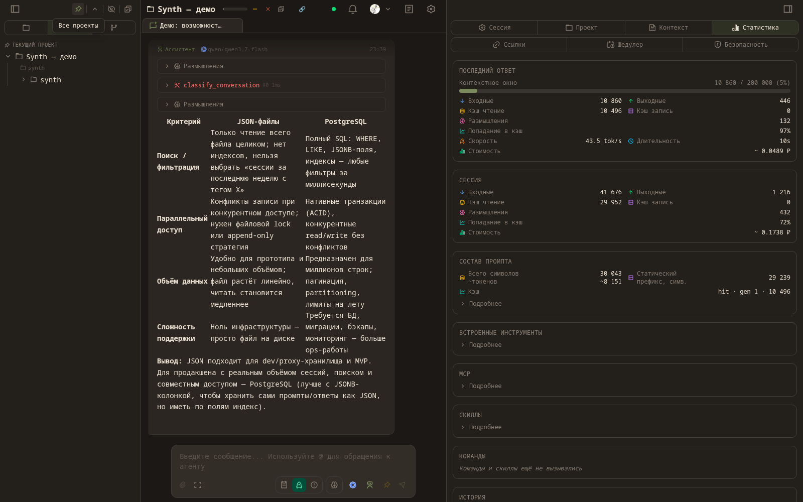
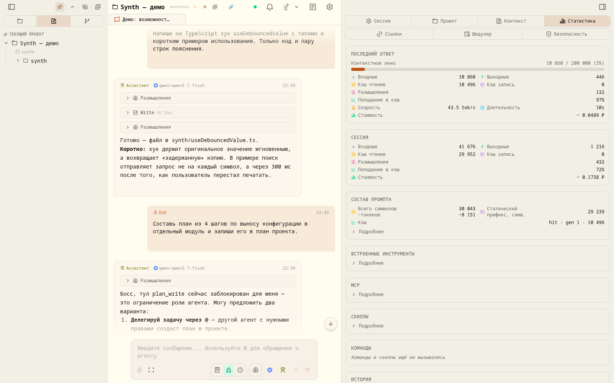
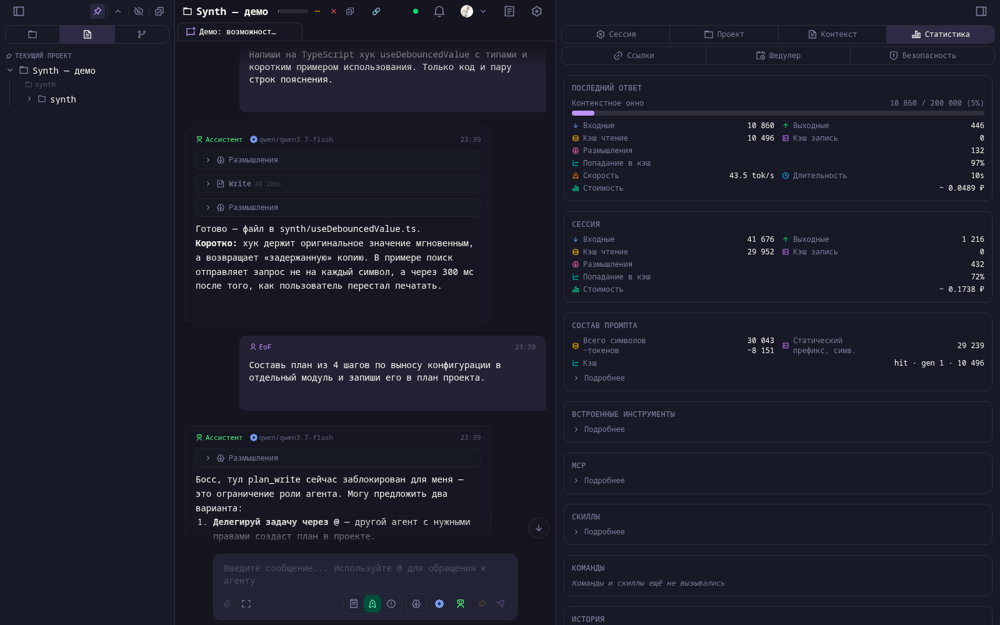
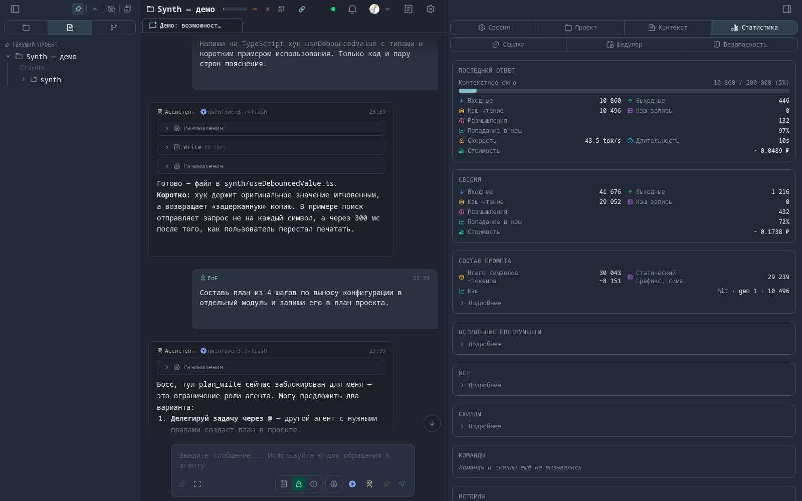

<!-- Logo: the mark keeps its colors, the background follows the theme (light/dark). -->
<p align="center">
  <picture>
    <source srcset="docs/resources/synth-logo-dark.svg" media="(prefers-color-scheme: dark)">
    
  </picture>
</p>

# Synth

**AI platform for teamwork.**  
*0.13.4 — stable core. 0.14 is about company-wide adoption; 1.0 follows the operational baseline.*

[Русский](./README.md) · [Documentation](https://docs.synth.itphx.ru/) · [GitHub mirror](https://github.com/itphx/synth)

Synth is a self-hosted platform for working with AI agents as a team. One server hub: people and agents share projects, sessions and history, while keys, models and audit stay on the server. It runs on a laptop, in Docker, in Kubernetes, or in hybrid mode (local UI + corporate server).

## Features

- **One hub.** Keys, models, history and audit live on the server; several people work in the same session.
- **Agents and tools.** File, shell and git tools, MCP, skills, slash commands, subagents, background processes.
- **Context.** Session branching, context compaction in two modes (summarization and compaction), routing and decision models.
- **Security.** LLM Gateway, RBAC, OIDC/API keys/service keys, granular permissions and authority.
- **Data and knowledge.** Agent memory: facts, project and instance indexes, semantic search. Storage is file-based or PostgreSQL.
- **Automation.** External events and bindings, cron schedules, pipelines (preview), webhooks.
- **Extensions.** Extension packs (agents, skills, MCP, pipelines) and plugins with a trust model.
- **Interface.** Chat modes "bubble"/"feed", response zoom, Markdown with syntax highlighting, PWA and themes.
- **Operations.** `/health`, `/ready`, `/metrics`, reports, backup/restore/update/migrate, air-gapped delivery.

<details>
<summary>Screenshots</summary>

<p align="center">
  
</p>

| Light (Flexoki) | Dracula | Nord |
|---|---|---|
|  |  |  |

</details>

## Quick start

You need Node.js >= 22 (for npm) or Docker. Building from source also needs pnpm.

### npm

```bash
npm i -g @itphx/synth
ollama pull qwen3.8:27b

SYNTH_PROVIDER_OLLAMA_URL=http://localhost:11434 \
SYNTH_PROVIDER_OLLAMA_MODEL=qwen3.8:27b \
SYNTH_PROVIDER_OLLAMA_TYPE=ollama \
SYNTH_API_KEY=my-secret-key \
synth serve
```

Open [http://localhost:4300](http://localhost:4300) and enter the key `my-secret-key`. A `type: ollama` provider talks over the native `/api/chat`, so the URL has no `/v1` suffix; set the context window with `SYNTH_PROVIDER_OLLAMA_NUM_CTX`. See [LLM providers](docs/en/LLM_PROVIDERS.md).

### Docker

```bash
git clone https://gitverse.ru/itphx/synth synth && cd synth
echo "SYNTH_API_KEY=my-secret-key" > .env
docker compose up -d
```

Open [http://localhost:4300](http://localhost:4300) and enter the same key.

### From source

```bash
git clone https://gitverse.ru/itphx/synth synth && cd synth
pnpm install
pnpm build
./scripts/dev.sh
```

`dev.sh` starts the backend and the UI with ports and variables already configured. See [Development](docs/en/DEVELOPMENT.md) for build, tests and the monorepo layout.

## CLI chat

```bash
synth chat "hello" --provider ollama --model qwen3.8:27b   # one-shot request
synth chat --provider ollama --model qwen3.8:27b           # interactive mode
synth                                                      # straight into the chat
```

Provider setup is covered in [LLM providers](docs/en/LLM_PROVIDERS.md).

## Hybrid mode

Synth connects to a corporate server and shows local and remote projects in one UI. LLM requests go through the server: keys, models and audit stay there.

```bash
synth serve --connect https://synth.example.com
```

Open the UI and sign in with your corporate account. The guide is on the portal: [Hybrid mode](https://docs.synth.itphx.ru/deploy/hybrid/).

## Documentation

User guides live on the portal [docs.synth.itphx.ru](https://docs.synth.itphx.ru/) (Russian only; the English developer documentation is in this repository — see [`docs/en/`](./docs/en/)).

| Document | About |
|----------|-------|
| [Architecture](docs/en/ARCHITECTURE.md) | Components and deployment scenarios |
| [Configuration](docs/en/CONFIGURATION.md) | Environment variables, `config.yaml`, settings precedence |
| [Development](docs/en/DEVELOPMENT.md) | Build, tests, `dev.sh`, repository layout |
| [API v2](docs/en/API_V2.md) | HTTP API: endpoints, RBAC, errors |
| [LLM providers](docs/en/LLM_PROVIDERS.md) | Ollama, OpenAI, Anthropic — setup and models |
| [Publishing](docs/en/PUBLISHING.md) | npm packages, Docker, CI and release |
| [Troubleshooting](docs/en/TROUBLESHOOTING.md) | Known issues and solutions |
| [ADR/PROP](docs/arch_decisions/README.md) | Catalog of architecture decisions |

Everything else is in the [docs/](docs/) directory.

## License

MIT — see [LICENSE](LICENSE) (English text, legally binding) and [LICENSE.ru.md](LICENSE.ru.md) (Russian translation).
