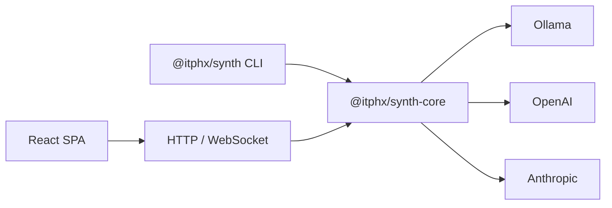

<!-- Логотип README: знак цветной, фон подставляется темой.
     Светлая тема — synth-logo-light.svg, тёмная — synth-logo-dark.svg (prefers-color-scheme).
     Пути без "./" — GitVerse ломает /raw/branch/<branch>/./<path>. -->
<p align="center">
  <picture>
    <source srcset="docs/resources/synth-logo-dark.svg" media="(prefers-color-scheme: dark)">
    
  </picture>
</p>

# Synth

**AI platform for teamwork.**  
*Status: MVP — active development, the core is stable. Version: 0.10.1.*

> 🌐 **English** · [Russian](./README.md)
> This is the public GitHub mirror — development happens on [GitVerse](https://gitverse.ru/itphx/synth); see [CONTRIBUTING.md](./CONTRIBUTING.md) for the PR workflow.

Synth is an AI platform for teamwork. It runs on your own infrastructure
(self-hosted, enterprise-ready) and also works on a personal machine — with no
backend, Keycloak or Kubernetes required.

One chat: your own agent with tools, MCP and skills.



---

## Screenshots

<p align="center">
  
</p>

| Chat and tools | Statistics | Agents |
|---|---|---|
|  |  |  |

| Audit log | Mobile chat | Mobile menu |
|---|---|---|
|  |  |  |

Themes:

| Light (Flexoki) | Dracula | Nord |
|---|---|---|
|  |  |  |

---

## Key features

| Area | Capability |
|---------|-------------|
| **Centralization** | A single hub for all of the team's AI agents. Collaboration: several users in one session, history on the server |
| **History and metadata** | JSON files with atomic writes (ADR-005): sessions, projects, providers, models. A normalized PostgreSQL schema (ADR-097) is planned |
| **Audit** | Every LLM request is logged (ADR-036): who, when, which model, how many tokens — full transparency |
| **Planning** | A project plan with a kanban structure (ADR-039): columns, priorities, dependencies; todo lives in the session. Managed by the `plan_*`/`todo_*` tools |
| **MCP** | Model Context Protocol support — pluggable tools and data sources |
| **Deployment** | Three scenarios: cloud (K8s), local (one command), hybrid (corporate hub + employee's PC) |
| **Security** | Multi-layered: RBAC (ADMIN/USER/LEAD/AUDITOR), OIDC, API keys, runner isolation |
| **Code control** | The agent shows and explains every step. You understand what the AI does instead of blindly accepting it |

---

## Quick start

> A step-by-step guide (installation, provider setup, first run) is on the portal:
> [docs.synth.itphx.ru/getting-started/quickstart](https://docs.synth.itphx.ru/getting-started/quickstart/).

### npm (global install)

```bash
npm i -g @itphx/synth

# Run with Ollama (local models)
ollama pull qwen3.8:27b

# type: ollama talks over the native /api/chat — specify the URL without the /v1 suffix.
# Compatibility: an old URL with /v1 (or /v1/chat/completions) still works — Synth
# strips the suffix and logs a warning. Ollama's OpenAI-compatible path is a
# separate provider: type: openai/generic.
SYNTH_PROVIDER_OLLAMA_URL=http://localhost:11434 \
SYNTH_PROVIDER_OLLAMA_MODEL=qwen3.8:27b \
SYNTH_PROVIDER_OLLAMA_TYPE=ollama \
SYNTH_API_KEY=my-secret-key \
synth serve
```

> **Context window.** `qwen3.8:27b` provides a window of ~100k–256k tokens, but
> Ollama serves only a small one by default. A provider with `type: ollama` talks
> over the native `/api/chat`, where `num_ctx` **does apply**: set the window
> through Synth (`SYNTH_PROVIDER_OLLAMA_NUM_CTX=262144` or the provider's `num_ctx`
> field), otherwise the Ollama server-side default applies
> (`OLLAMA_CONTEXT_LENGTH=262144 ollama serve` or a model built with
> `PARAMETER num_ctx 262144`). See
> [LLM providers](docs/LLM_PROVIDERS.md) for details.

Open [http://localhost:4300](http://localhost:4300) and enter the key `my-secret-key`.

### Docker Compose

```bash
git clone https://gitverse.ru/itphx/synth synth && cd synth
echo "SYNTH_API_KEY=my-secret-key" > .env
docker compose up -d
```

Open [http://localhost:4300](http://localhost:4300) and enter the key `my-secret-key`.

### From source (development)

```bash
git clone https://gitverse.ru/itphx/synth synth && cd synth
pnpm install
pnpm build

# Run through the thin CLI wrapper (@itphx/synth): the UI is resolved from @itphx/synth-ui automatically
node packages/synth/dist/cli.js serve --api-key my-secret-key
```

For development use `./scripts/dev.sh` (backend + UI, ports and variables already configured).

**Requirements:** Node.js >= 22, pnpm >= 11

---

## CLI chat

```bash
# One-shot request
synth chat "hello" --provider ollama --model qwen3.8:27b

# Interactive mode
synth chat --provider ollama --model qwen3.8:27b

# Just synth — straight into the interactive chat
synth
```

See [LLM providers](docs/LLM_PROVIDERS.md) and the [Quick start on the portal](https://docs.synth.itphx.ru/getting-started/quickstart/) for provider setup.

---

## Documentation

### User documentation

The canonical source of user guides is the portal
**[docs.synth.itphx.ru](https://docs.synth.itphx.ru/)** — available in Russian;
an English version is planned.

- [Quick start](https://docs.synth.itphx.ru/getting-started/quickstart/)
- [Providers](https://docs.synth.itphx.ru/getting-started/providers/)
- [Hybrid mode](https://docs.synth.itphx.ru/deploy/hybrid/)
- [Administration](https://docs.synth.itphx.ru/admin/configuration/)
- [CLI](https://docs.synth.itphx.ru/help/cli/)
- [FAQ](https://docs.synth.itphx.ru/help/faq/)

### Developer documentation

| File | About |
|------|-------|
| [Architecture](docs/ARCHITECTURE.md) | Components, deployment scenarios, full diagram |
| [Configuration](docs/CONFIGURATION.md) | Environment variables, `config.yaml`, settings precedence |
| [Development](docs/DEVELOPMENT.md) | Build, tests, `dev.sh`, monorepo structure |
| [Publishing and release](docs/PUBLISHING.md) | npm packages, Docker, CI release |
| [API v2](docs/API_V2.md) | HTTP API reference: endpoints, RBAC, errors |
| [Routing](docs/ROUTING.md) | Fast answers, model selection, embeddings |
| [Keycloak (OIDC)](docs/KEYCLOAK.md) | Keycloak setup, role provisioning, Synth parameters for the integration |
| [LLM providers](docs/LLM_PROVIDERS.md) | Ollama, OpenAI, Anthropic — setup and models |
| [Troubleshooting](docs/TROUBLESHOOTING.md) | Known issues and solutions |
| [Architecture decisions](docs/arch_decisions/README.md) | ADR/PROP catalog: rationale and decision history |

> The English catalog of developer docs is in progress — see
> [docs/en/README.md](docs/en/README.md); mandatory terminology is in
> [docs/en/GLOSSARY.md](docs/en/GLOSSARY.md).

---

## Hybrid mode (local + server)

> The user guide for hybrid mode is on the portal:
> [docs.synth.itphx.ru/deploy/hybrid](https://docs.synth.itphx.ru/deploy/hybrid/).

Synth connects to a corporate server (for example `https://synth.k3s.itphx.loc`),
combining local and remote projects/sessions in one UI. LLM requests are
centralized — they go through the server (keys, models and audit live only there).

A convenient way to start is `./scripts/hybrid.sh [SERVER_URL]` (build + CA + OIDC flags):

```bash
# The address is known — log in to the UI with username/password
./scripts/hybrid.sh https://synth.k3s.itphx.loc

# The address is unknown — the UI shows a "Server address" field and username/password
./scripts/hybrid.sh
```

The manual equivalent:

```bash
synth serve --connect https://synth.k3s.itphx.loc \
  --oidc-issuer https://keycloak.itphx.loc/realms/synth \
  --oidc-client-id synth-cli
```

Startup is non-blocking (no device flow in the console): the server comes up
"cold", and after listening a silent auto-login runs using saved credentials
(or `--token`); if there are none, you sign in to the UI with username/password
(ROPC "behind the scenes", the identity comes from the server). The core learns
the OIDC issuer/client_id from the server (`GET /auth/oidc-meta`) with a fallback
to `--oidc-issuer`/`--oidc-client-id`.

See [docs/HYBRID.md](docs/HYBRID.md) for details.

---

## License

MIT — see [LICENSE](LICENSE) (English text, legally binding) and
[LICENSE.ru.md](LICENSE.ru.md) (Russian translation).
