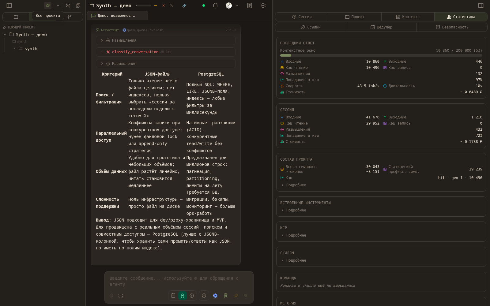
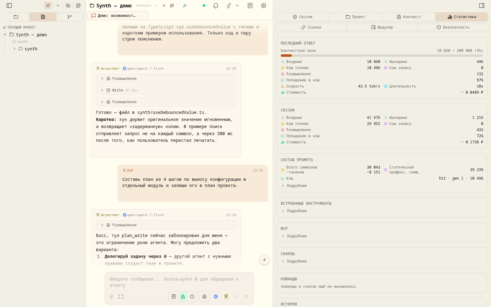
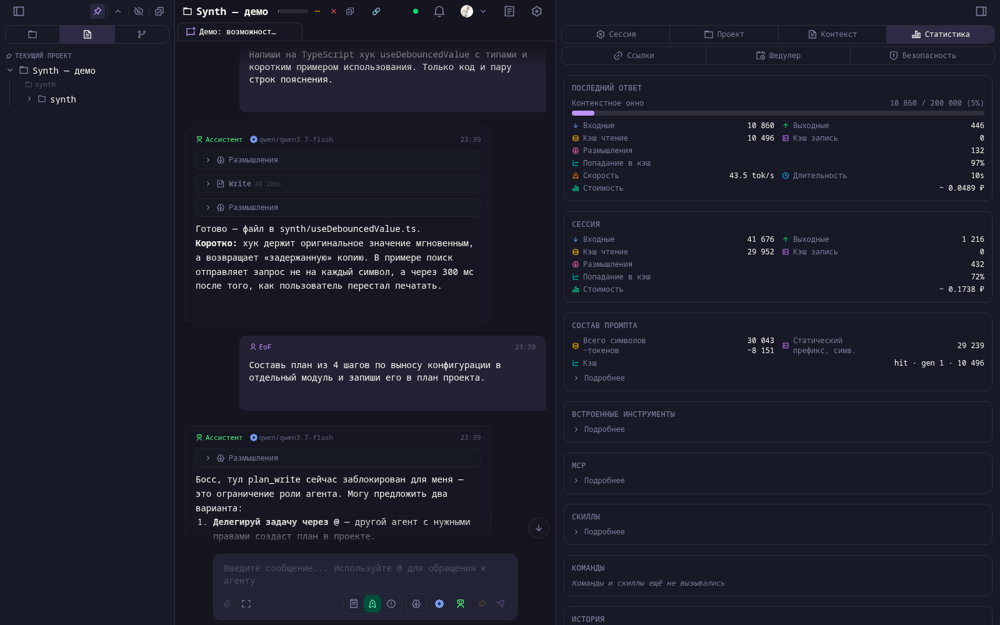
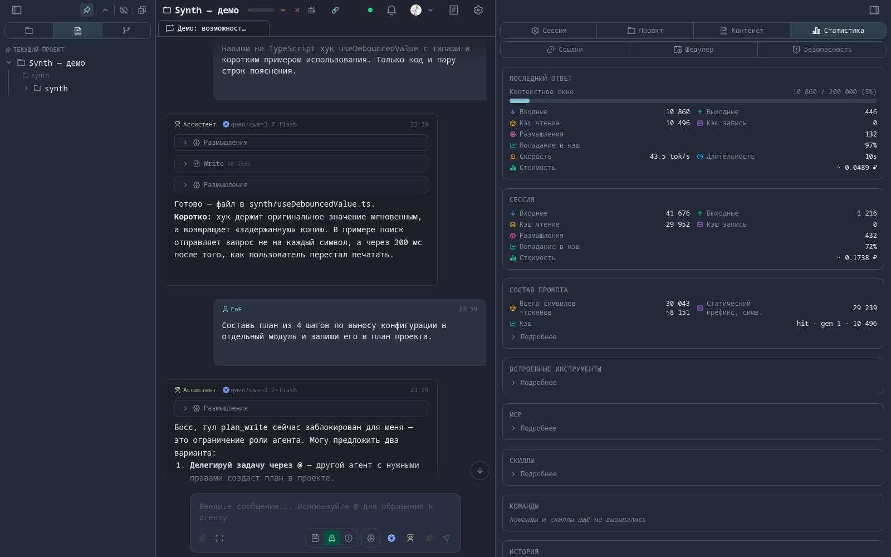

<!-- Логотип: знак цветной, фон подставляется темой (светлая/тёмная). -->
<p align="center">
  <picture>
    <source srcset="docs/resources/synth-logo-dark.svg" media="(prefers-color-scheme: dark)">
    
  </picture>
</p>

# Synth

**AI-платформа для командной работы.**  
*0.13.4 — стабильное ядро. 0.14 — внедрение в компанию; 1.0 — после эксплуатационного минимума.*

[English](./README.en.md) · [Документация](https://docs.synth.itphx.ru/) · [GitHub-зеркало](https://github.com/itphx/synth)

Synth — self-hosted платформа для работы с AI-агентами в команде. Один сервер-хаб: люди и агенты делят проекты, сессии и историю, а ключи, модели и аудит остаются на сервере. Запускается на ноутбуке, в Docker, в Kubernetes или в гибридном режиме «локальный UI + корпоративный сервер».

## Возможности

- **Единый хаб.** Ключи, модели, история и аудит — на сервере; несколько человек работают в одной сессии.
- **Агенты и инструменты.** Файловые, shell- и git-инструменты, MCP, скиллы, slash-команды, саб-агенты, фоновые процессы.
- **Контекст.** Ветвление сессий, сжатие контекста в двух режимах — суммаризация и компактизация, маршрутизация и decision-модели.
- **Безопасность.** LLM Gateway, RBAC, OIDC/API-ключи/service-keys, гранулярные права и полномочия.
- **Данные и знания.** Память агентов: факты, индексы проекта и инстанса, семантический поиск. Хранилище — файлы или PostgreSQL.
- **Автоматизация.** Внешние события и привязки, cron-расписания, пайплайны (preview), webhooks.
- **Расширения.** Пакеты расширений (агенты, скиллы, MCP, пайплайны) и плагины с моделью доверия.
- **Интерфейс.** Режимы чата «пузырь»/«лента», зум ответов, Markdown с подсветкой, PWA и темы.
- **Эксплуатация.** `/health`, `/ready`, `/metrics`, отчёты, backup/restore/update/migrate, air-gapped поставка.

<details>
<summary>Скриншоты</summary>

<p align="center">
  
</p>

| Светлая (Flexoki) | Dracula | Nord |
|---|---|---|
|  |  |  |

</details>

## Быстрый старт

Нужен Node.js >= 22 (для npm) или Docker. Для сборки из исходников — ещё и pnpm.

### npm

```bash
npm i -g @itphx/synth
ollama pull qwen3.8:27b

SYNTH_PROVIDER_OLLAMA_URL=http://localhost:11434 \
SYNTH_PROVIDER_OLLAMA_MODEL=qwen3.8:27b \
SYNTH_PROVIDER_OLLAMA_TYPE=ollama \
SYNTH_API_KEY=my-secret-key \
synth serve
```

Откройте [http://localhost:4300](http://localhost:4300) и введите ключ `my-secret-key`. Провайдер `type: ollama` работает через нативный `/api/chat`, поэтому URL указывается без `/v1`; контекстное окно задаётся переменной `SYNTH_PROVIDER_OLLAMA_NUM_CTX`. Подробнее — [LLM-провайдеры](docs/LLM_PROVIDERS.md).

### Docker

```bash
git clone https://gitverse.ru/itphx/synth synth && cd synth
echo "SYNTH_API_KEY=my-secret-key" > .env
docker compose up -d
```

Откройте [http://localhost:4300](http://localhost:4300) и введите тот же ключ.

### Из исходников

```bash
git clone https://gitverse.ru/itphx/synth synth && cd synth
pnpm install
pnpm build
./scripts/dev.sh
```

`dev.sh` поднимает backend и UI с готовыми портами и переменными. Сборка, тесты и структура монорепозитория — подробнее в разделе [«Разработка»](docs/DEVELOPMENT.md).

## CLI-чат

```bash
synth chat "привет" --provider ollama --model qwen3.8:27b   # один запрос
synth chat --provider ollama --model qwen3.8:27b            # интерактивно
synth                                                       # сразу в чат
```

Настройка провайдеров — [LLM-провайдеры](docs/LLM_PROVIDERS.md).

## Гибридный режим

Synth подключается к корпоративному серверу и показывает локальные и удалённые проекты в одном UI. LLM-запросы идут через сервер: ключи, модели и аудит остаются на нём.

```bash
synth serve --connect https://synth.example.com
```

Откройте UI и войдите в корпоративную учётную запись. Руководство — на портале: [Гибридный режим](https://docs.synth.itphx.ru/deploy/hybrid/).

## Документация

Пользовательские руководства — на портале [docs.synth.itphx.ru](https://docs.synth.itphx.ru/) (только на русском; английская документация для разработчиков — в [`README.en.md`](README.en.md) и [`docs/en/`](docs/en/)).

| Документ | О чём |
|----------|-------|
| [Архитектура](docs/ARCHITECTURE.md) | Компоненты и сценарии развёртывания |
| [Конфигурация](docs/CONFIGURATION.md) | Переменные окружения, `config.yaml`, приоритет настроек |
| [Разработка](docs/DEVELOPMENT.md) | Сборка, тесты, `dev.sh`, структура репозитория |
| [API v2](docs/API_V2.md) | HTTP API: эндпоинты, RBAC, ошибки |
| [LLM-провайдеры](docs/LLM_PROVIDERS.md) | Ollama, OpenAI, Anthropic — настройка и модели |
| [Публикация](docs/PUBLISHING.md) | npm-пакеты, Docker, CI и релиз |
| [Диагностика](docs/TROUBLESHOOTING.md) | Известные проблемы и решения |
| [ADR/PROP](docs/arch_decisions/README.md) | Каталог архитектурных решений |

Остальное — в каталоге [docs/](docs/).

## Лицензия

MIT — [LICENSE](LICENSE) (английский текст, имеющий юридическую силу) и [LICENSE.ru.md](LICENSE.ru.md) (русский перевод).
