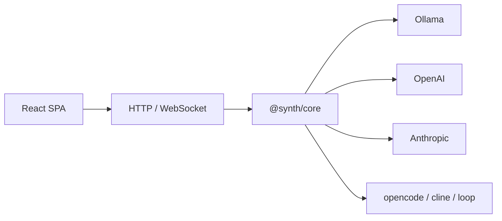

<p align="center">
  
</p>

# Synth

**Корпоративная AI-агентная платформа.**  
*Статус: MVP — активная разработка, ядро стабильно.*

Synth — система для командной работы с AI-агентами. Легко разворачивается на инфраструктуре компании, но при этом работает и на личной машине — без бэкенда, Keycloak и Kubernetes.

Объединяет собственный движок с opencode и cline в едином интерфейсе: один чат — разные агенты.



---

## Ключевые возможности

| Область | Возможность |
|---------|-------------|
| **Централизация** | Единый хаб для всех AI-агентов команды. Коллаборация: несколько пользователей в одной сессии, история — на сервере |
| **PostgreSQL** | Надёжное хранилище сессий, проектов, метаданных. Отказоустойчивость и консистентность |
| **Аудит** | Каждый LLM-запрос логируется. Кто, когда, какой модели, сколько токенов — полная прозрачность |
| **Kanban** | Управление задачами агентов через Kanban-доску. Статусы, назначения, приоритеты |
| **MCP** | Поддержка Model Context Protocol — подключаемые инструменты и источники данных |
| **RAG** | Retrieval Augmented Generation — поиск по базе знаний для более точных ответов |
| **Skills** | Переиспользуемые навыки — упакованные сценарии (код-ревью, деплой, тестирование) |
| **Loops** | Циклические агентные пайплайны — задача уходит агенту, результат проверяется, цикл повторяется до достижения критерия |
| **Развёртывание** | Четыре сценария: облачный (K8s), локальный (одна команда), гибридный (корпоративный хаб + ПК сотрудника), внешние движки |
| **Безопасность** | Многоуровневая: RBAC (ADMIN/USER/LEAD/AUDITOR), OIDC, API-ключи, изоляция раннеров |
| **Контроль кода** | Агент показывает и поясняет каждый шаг. Пользователь понимает что делает AI, а не слепо принимает |
| **Обучение** | Система анализирует паттерны использования и предлагает оптимизации: какой провайдер/модель эффективнее, какие навыки стоит подключить |

---

## Быстрый старт

### npm (глобальная установка)

```bash
npm i -g @itphx/synth

# Запуск с Ollama (локальные модели)
ollama pull qwen3.5

SYNTH_PROVIDER_OLLAMA_URL=http://localhost:11434/v1 \
SYNTH_PROVIDER_OLLAMA_MODEL=qwen3.5 \
SYNTH_PROVIDER_OLLAMA_TYPE=ollama \
SYNTH_API_KEY=my-secret-key \
synth serve
```

Откройте [http://localhost:4300](http://localhost:4300), введите ключ `my-secret-key`.

### Docker Compose

```bash
git clone <repo-url> synth && cd synth
echo "SYNTH_API_KEY=my-secret-key" > .env
docker compose up -d
```

Откройте [http://localhost:4300](http://localhost:4300), введите ключ `my-secret-key`.

### Из исходников (разработка)

```bash
git clone <repo-url> synth && cd synth
pnpm install
pnpm build
node packages/core/dist/main.js serve --api-key my-secret-key --ui packages/ui/dist
```

**Требования:** Node.js >= 22, pnpm >= 11

---

## CLI-чат

```bash
# Одноразовый запрос
synth chat "привет" --provider ollama --model qwen3.5

# Интерактивный режим
synth chat --provider ollama --model qwen3.5

# Просто synth — сразу в интерактивный чат
synth
```

---

## Документация

| Раздел | О чём |
|--------|-------|
| [Архитектура](docs/ARCHITECTURE.md) | Компоненты, сценарии развёртывания, полная схема |
| [Конфигурация](docs/CONFIGURATION.md) | Переменные окружения, `config.yaml`, приоритет настроек |
| [LLM-провайдеры](docs/LLM_PROVIDERS.md) | Ollama, OpenAI, Anthropic — настройка и модели |
| [Разработка](docs/DEVELOPMENT.md) | Сборка, тесты, `dev.sh`, структура монорепозитория |
| [Архитектурные решения](AGENTS.md) | AD, мотивировка, история решений |

---

## Лицензия

MIT
