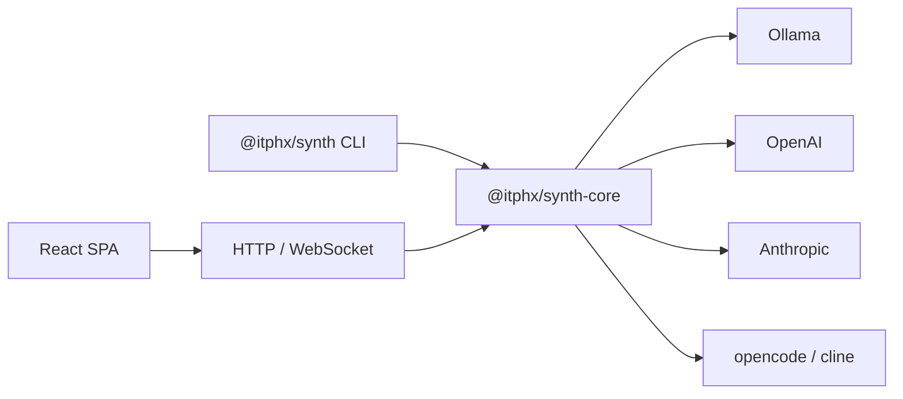

<p align="center">
  
</p>

# Synth

**Корпоративная AI-агентная платформа.**  
*Статус: MVP — активная разработка, ядро стабильно. Версия: 0.3.0.*

Synth — система для командной работы с AI-агентами. Легко разворачивается на инфраструктуре компании, но при этом работает и на личной машине — без бэкенда, Keycloak и Kubernetes.

Объединяет собственный движок с opencode и cline в едином интерфейсе: один чат — разные агенты.



---

## Ключевые возможности

| Область | Возможность |
|---------|-------------|
| **Централизация** | Единый хаб для всех AI-агентов команды. Коллаборация: несколько пользователей в одной сессии, история — на сервере |
| **История и метаданные** | JSON-файлы с атомарной записью (AD-005): сессии, проекты, провайдеры, модели. Нормализованная схема на SQLite (AD-032) — в планах |
| **Аудит** | Каждый LLM-запрос логируется (AD-036): кто, когда, какой модели, сколько токенов — полная прозрачность |
| **Планирование** | План проекта с kanban-структурой (AD-039): колонки, приоритеты, зависимости; todo — в сессии. Управляется инструментами `plan_*`/`todo_*` |
| **MCP** | Поддержка Model Context Protocol — подключаемые инструменты и источники данных |
| **Развёртывание** | Четыре сценария: облачный (K8s), локальный (одна команда), гибридный (корпоративный хаб + ПК сотрудника), внешние движки |
| **Безопасность** | Многоуровневая: RBAC (ADMIN/USER/LEAD/AUDITOR), OIDC, API-ключи, изоляция раннеров |
| **Контроль кода** | Агент показывает и поясняет каждый шаг. Пользователь понимает что делает AI, а не слепо принимает |

---

## Быстрый старт

### npm (глобальная установка)

```bash
npm i -g @itphx/synth

# Запуск с Ollama (локальные модели)
ollama pull qwen3:14b

SYNTH_PROVIDER_OLLAMA_URL=http://localhost:11434/v1 \
SYNTH_PROVIDER_OLLAMA_MODEL=qwen3:14b \
SYNTH_PROVIDER_OLLAMA_TYPE=ollama \
SYNTH_API_KEY=my-secret-key \
synth serve
```

Откройте [http://localhost:4300](http://localhost:4300), введите ключ `my-secret-key`.

### Docker Compose

```bash
git clone <repo-url> synth && cd synth
echo "SYNTH_API_KEY=my-secret-key" > .env
docker compose up -d
```

Откройте [http://localhost:4300](http://localhost:4300), введите ключ `my-secret-key`.

### Из исходников (разработка)

```bash
git clone <repo-url> synth && cd synth
pnpm install
pnpm build

# Запуск через тонкую CLI-обёртку (@itphx/synth): UI резолвится из @itphx/synth-ui автоматически
node packages/synth/dist/cli.js serve --api-key my-secret-key
```

Для разработки используйте `./scripts/dev.sh` (backend + UI, порты и переменные настроены).

**Требования:** Node.js >= 22, pnpm >= 11

---

## CLI-чат

```bash
# Одноразовый запрос
synth chat "привет" --provider ollama --model qwen3:14b

# Интерактивный режим
synth chat --provider ollama --model qwen3:14b

# Просто synth — сразу в интерактивный чат
synth
```

Подробнее о настройке провайдеров — [LLM-провайдеры](docs/LLM_PROVIDERS.md) и [Быстрый старт](docs/QUICKSTART.md).

---

## Документация

| Раздел | О чём |
|--------|-------|
| [Быстрый старт](docs/QUICKSTART.md) | Установка, настройка провайдера, первый запуск |
| [Архитектура](docs/ARCHITECTURE.md) | Компоненты, сценарии развёртывания, полная схема |
| [Конфигурация](docs/CONFIGURATION.md) | Переменные окружения, `config.yaml`, приоритет настроек |
| [Keycloak (OIDC)](docs/KEYCLOAK.md) | Настройка Keycloak, выдача ролей, параметры Synth для связки |
| [LLM-провайдеры](docs/LLM_PROVIDERS.md) | Ollama, OpenAI, Anthropic — настройка и модели |
| [Разработка](docs/DEVELOPMENT.md) | Сборка, тесты, `dev.sh`, структура монорепозитория |
| [Маршрутизация](docs/ROUTING.md) | Быстрые ответы, выбор модели, эмбеддинги |
| [Публикация и релиз](docs/PUBLISHING.md) | npm-пакеты, Docker, CI-релиз |
| [Диагностика](docs/TROUBLESHOOTING.md) | Известные проблемы и решения |
| [Архитектурные решения](AGENTS.md) | AD, мотивировка, история решений |

---

## Гибридный режим (локально + сервер)

Synth подключается к корпоративному серверу (например `https://synth.k3s.itphx.loc`),
объединяя локальные и удалённые проекты/сессии в одном UI. LLM-запросы
централизованы — идут через сервер (ключи, модели и аудит — только на нём).

Удобный запуск — `./scripts/hybrid.sh [SERVER_URL]` (сборка + CA + OIDC-флаги):

```bash
# Адрес известен — в UI войти логином/паролем
./scripts/hybrid.sh https://synth.k3s.itphx.loc

# Адрес не известен — UI покажет поле «Адрес сервера» и логин/пароль
./scripts/hybrid.sh
```

Эквивалент вручную:

```bash
synth serve --connect https://synth.k3s.itphx.loc \
  --oidc-issuer https://keycloak.itphx.loc/realms/synth \
  --oidc-client-id synth-cli
```

Старт не блокируется (никакого device flow в консоли): сервер поднимается
«холодным», после listen выполняется тихий авто-логин по сохранённым credentials
(или `--token`); если их нет — вход в UI по логину/паролю (ROPC «за кулисами»,
личность приходит с сервера). OIDC issuer/client_id core узнаёт с сервера
(`GET /auth/oidc-meta`) с fallback на `--oidc-issuer`/`--oidc-client-id`.

Подробнее — [docs/HYBRID.md](docs/HYBRID.md).

---

## Лицензия

MIT
