<p align="center">
  
</p>

# Synth

**AI-платформа для командной работы.**  
*Статус: MVP — активная разработка, ядро стабильно. Версия: 0.10.0.*

> 🌐 [English](./README.en.md) · **Русский**
> Зеркало: [GitHub](https://github.com/itphx/synth).

Synth — AI-платформа для командной работы. Разворачивается на своей инфраструктуре (self-hosted, enterprise-ready), но при этом работает и на личной машине — без бэкенда, Keycloak и Kubernetes.

Один чат: собственный агент с инструментами, MCP и скиллами.

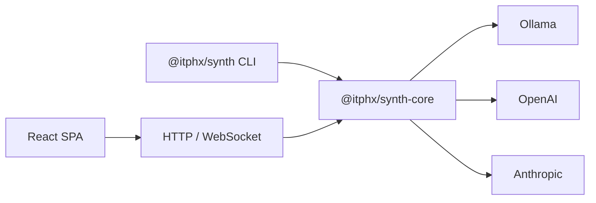

---

## Скриншоты

<p align="center">
  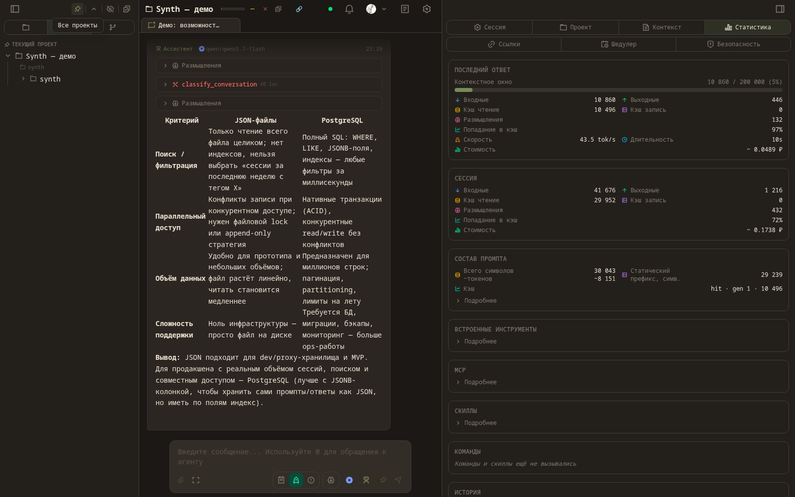
</p>

| Чат и инструменты | Статистика | Агенты |
|---|---|---|
| 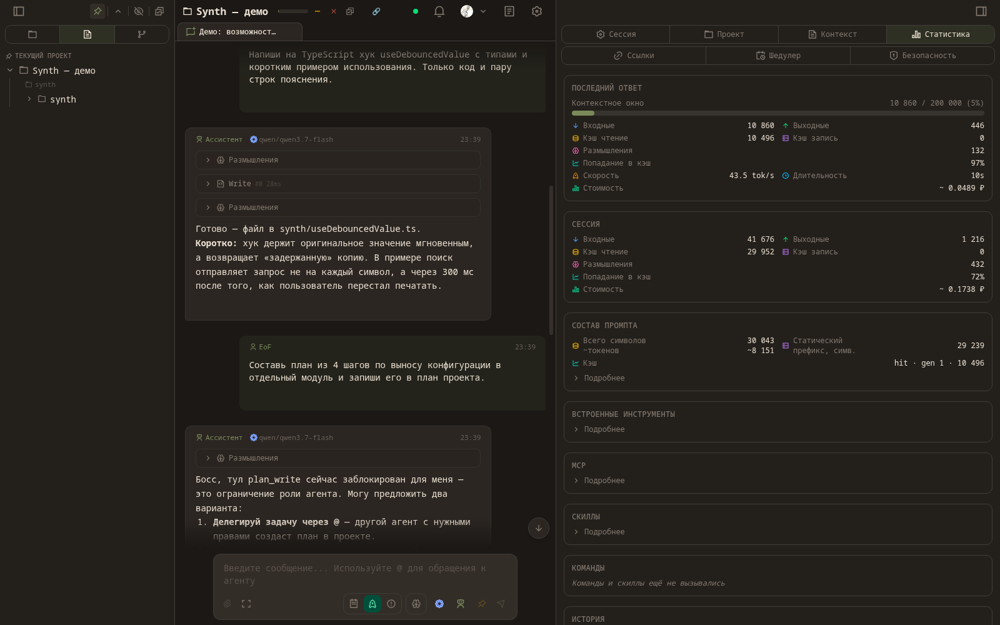 | 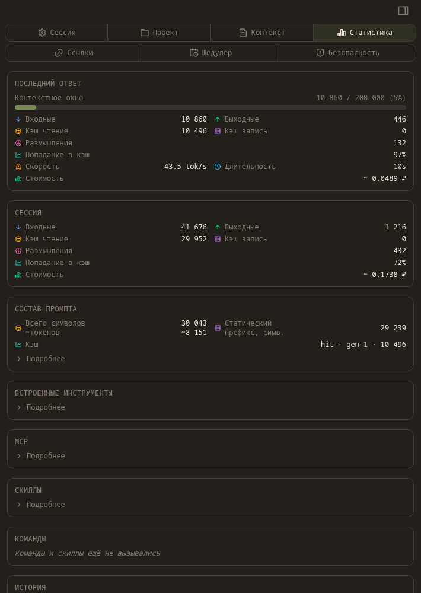 | 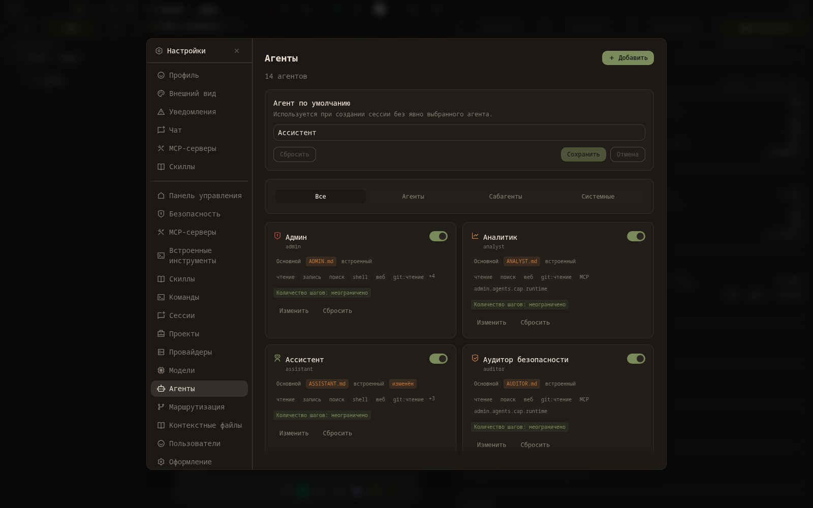 |

| Журнал аудита | Мобильный чат | Мобильное меню |
|---|---|---|
| 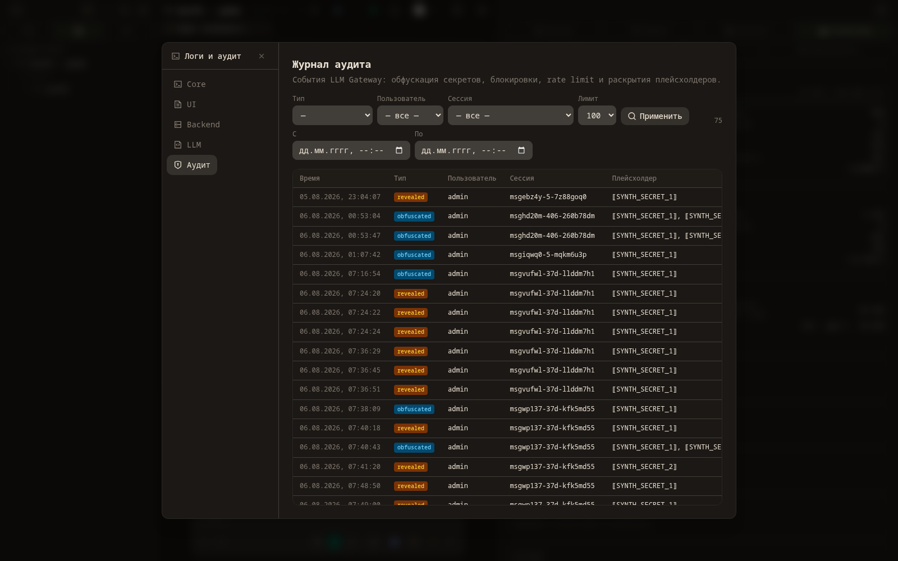 | 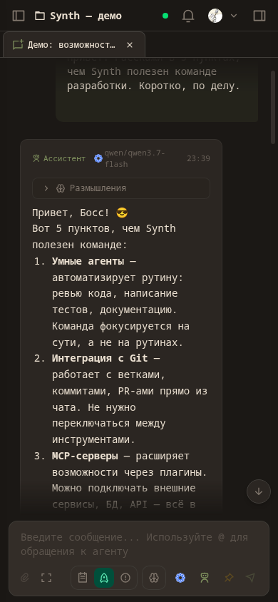 | 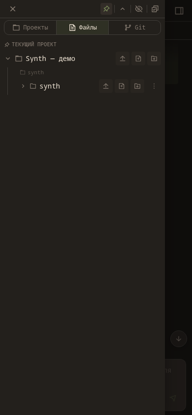 |

Темы оформления:

| Светлая (Flexoki) | Dracula | Nord |
|---|---|---|
| 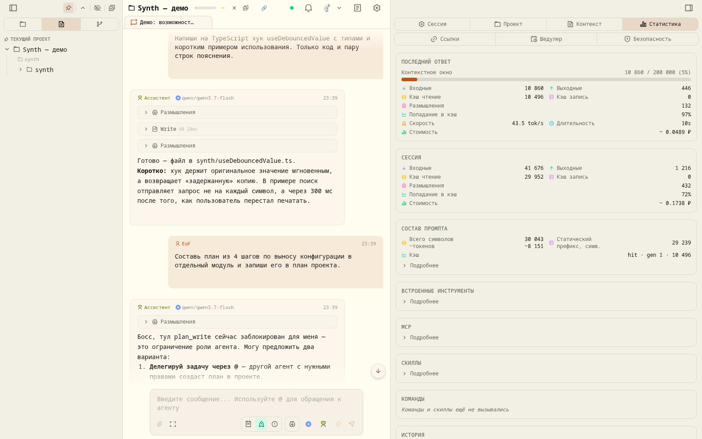 | 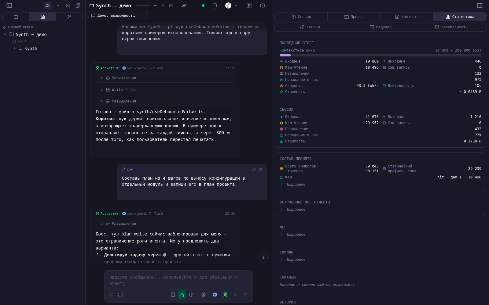 | 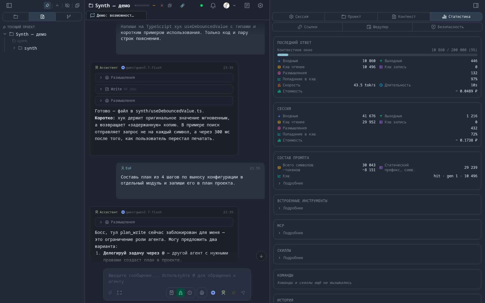 |

---

## Ключевые возможности

| Область | Возможность |
|---------|-------------|
| **Централизация** | Единый хаб для всех AI-агентов команды. Коллаборация: несколько пользователей в одной сессии, история — на сервере |
| **История и метаданные** | JSON-файлы с атомарной записью (ADR-005): сессии, проекты, провайдеры, модели. Нормализованная схема на PostgreSQL (PROP-032) — в планах |
| **Аудит** | Каждый LLM-запрос логируется (ADR-036): кто, когда, какой модели, сколько токенов — полная прозрачность |
| **Планирование** | План проекта с kanban-структурой (ADR-039): колонки, приоритеты, зависимости; todo — в сессии. Управляется инструментами `plan_*`/`todo_*` |
| **MCP** | Поддержка Model Context Protocol — подключаемые инструменты и источники данных |
| **Развёртывание** | Три сценария: облачный (K8s), локальный (одна команда), гибридный (корпоративный хаб + ПК сотрудника) |
| **Безопасность** | Многоуровневая: RBAC (ADMIN/USER/LEAD/AUDITOR), OIDC, API-ключи, изоляция раннеров |
| **Контроль кода** | Агент показывает и поясняет каждый шаг. Пользователь понимает что делает AI, а не слепо принимает |

---

## Быстрый старт

> Пошаговое руководство (установка, настройка провайдера, первый запуск) — на портале:
> [docs.synth.itphx.ru/getting-started/quickstart](https://docs.synth.itphx.ru/getting-started/quickstart/).

### npm (глобальная установка)

```bash
npm i -g @itphx/synth

# Запуск с Ollama (локальные модели)
ollama pull qwen3.8:27b

# Ollama ≥0.32: используйте OpenAI-совместимый URL с суффиксом /v1
# (Synth достроит /v1/chat/completions). Без /v1 используется нативный /api/chat.
SYNTH_PROVIDER_OLLAMA_URL=http://localhost:11434/v1 \
SYNTH_PROVIDER_OLLAMA_MODEL=qwen3.8:27b \
SYNTH_PROVIDER_OLLAMA_TYPE=ollama \
SYNTH_API_KEY=my-secret-key \
synth serve
```

> **Контекстное окно.** `qwen3.8:27b` даёт окно ~100k–256k токенов, но Ollama по
> умолчанию поднимает его небольшим. Synth ходит на OpenAI-совместимый `/v1`, где
> `num_ctx` не передаётся, поэтому «сырое» окно задаётся **на стороне Ollama**:
> запускайте сервер с `OLLAMA_CONTEXT_LENGTH=262144 ollama serve` (или соберите
> модель с `PARAMETER num_ctx 262144`). Подробнее —
> [LLM-провайдеры](docs/LLM_PROVIDERS.md).

Откройте [http://localhost:4300](http://localhost:4300), введите ключ `my-secret-key`.

### Docker Compose

```bash
git clone https://gitverse.ru/itphx/synth synth && cd synth
echo "SYNTH_API_KEY=my-secret-key" > .env
docker compose up -d
```

Откройте [http://localhost:4300](http://localhost:4300), введите ключ `my-secret-key`.

### Из исходников (разработка)

```bash
git clone https://gitverse.ru/itphx/synth synth && cd synth
pnpm install
pnpm build

# Запуск через тонкую CLI-обёртку (@itphx/synth): UI резолвится из @itphx/synth-ui автоматически
node packages/synth/dist/cli.js serve --api-key my-secret-key
```

Для разработки используйте `./scripts/dev.sh` (backend + UI, порты и переменные настроены).

**Требования:** Node.js >= 22, pnpm >= 11

---

## CLI-чат

```bash
# Одноразовый запрос
synth chat "привет" --provider ollama --model qwen3.8:27b

# Интерактивный режим
synth chat --provider ollama --model qwen3.8:27b

# Просто synth — сразу в интерактивный чат
synth
```

Подробнее о настройке провайдеров — [LLM-провайдеры](docs/LLM_PROVIDERS.md) и [Быстрый старт на портале](https://docs.synth.itphx.ru/getting-started/quickstart/).

---

## Документация

### Пользовательская документация

Канонический источник пользовательских руководств — портал
**[docs.synth.itphx.ru](https://docs.synth.itphx.ru/)** (на русском; английская
версия — в планах):

- [Быстрый старт](https://docs.synth.itphx.ru/getting-started/quickstart/)
- [Провайдеры](https://docs.synth.itphx.ru/getting-started/providers/)
- [Гибридный режим](https://docs.synth.itphx.ru/deploy/hybrid/)
- [Администрирование](https://docs.synth.itphx.ru/admin/configuration/)
- [CLI](https://docs.synth.itphx.ru/help/cli/)
- [FAQ](https://docs.synth.itphx.ru/help/faq/)

### Документация для разработчиков

| Файл | О чём |
|------|-------|
| [Архитектура](docs/ARCHITECTURE.md) | Компоненты, сценарии развёртывания, полная схема |
| [Конфигурация](docs/CONFIGURATION.md) | Переменные окружения, `config.yaml`, приоритет настроек |
| [Разработка](docs/DEVELOPMENT.md) | Сборка, тесты, `dev.sh`, структура монорепозитория |
| [Публикация и релиз](docs/PUBLISHING.md) | npm-пакеты, Docker, CI-релиз |
| [API v2](docs/API_V2.md) | Справочник HTTP API: эндпоинты, RBAC, ошибки |
| [Маршрутизация](docs/ROUTING.md) | Быстрые ответы, выбор модели, эмбеддинги |
| [Keycloak (OIDC)](docs/KEYCLOAK.md) | Настройка Keycloak, выдача ролей, параметры Synth для связки |
| [LLM-провайдеры](docs/LLM_PROVIDERS.md) | Ollama, OpenAI, Anthropic — настройка и модели |
| [Диагностика](docs/TROUBLESHOOTING.md) | Известные проблемы и решения |
| [Архитектурные решения](docs/arch_decisions/README.md) | Каталог AD: мотивировка и история решений |

---

## Гибридный режим (локально + сервер)

> Пользовательское руководство по гибридному режиму — на портале:
> [docs.synth.itphx.ru/deploy/hybrid](https://docs.synth.itphx.ru/deploy/hybrid/).

Synth подключается к корпоративному серверу (например `https://synth.k3s.itphx.loc`),
объединяя локальные и удалённые проекты/сессии в одном UI. LLM-запросы
централизованы — идут через сервер (ключи, модели и аудит — только на нём).

Удобный запуск — `./scripts/hybrid.sh [SERVER_URL]` (сборка + CA + OIDC-флаги):

```bash
# Адрес известен — в UI войти логином/паролем
./scripts/hybrid.sh https://synth.k3s.itphx.loc

# Адрес не известен — UI покажет поле «Адрес сервера» и логин/пароль
./scripts/hybrid.sh
```

Эквивалент вручную:

```bash
synth serve --connect https://synth.k3s.itphx.loc \
  --oidc-issuer https://keycloak.itphx.loc/realms/synth \
  --oidc-client-id synth-cli
```

Старт не блокируется (никакого device flow в консоли): сервер поднимается
«холодным», после listen выполняется тихий авто-логин по сохранённым credentials
(или `--token`); если их нет — вход в UI по логину/паролю (ROPC «за кулисами»,
личность приходит с сервера). OIDC issuer/client_id core узнаёт с сервера
(`GET /auth/oidc-meta`) с fallback на `--oidc-issuer`/`--oidc-client-id`.

Подробнее — [docs/HYBRID.md](docs/HYBRID.md).

---

## Лицензия

MIT — см. [LICENSE](LICENSE) (английский текст, имеющий юридическую силу) и
[LICENSE.ru.md](LICENSE.ru.md) (русский перевод).
