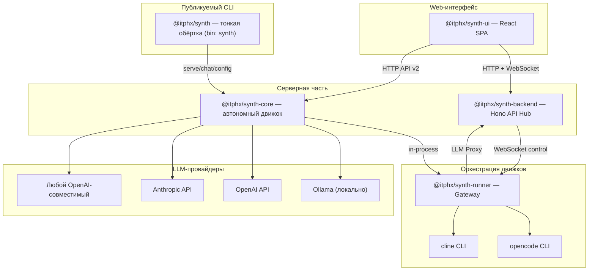
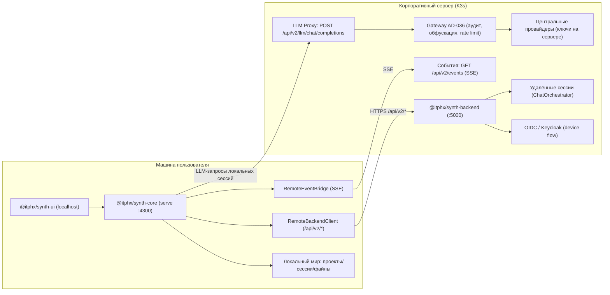

# Архитектура Synth

> [!NOTE]
> Пользовательские сценарии развёртывания (локально, Docker, Kubernetes, гибрид) —
> в портале документации: https://docs.synth.itphx.ru/deploy/local/.

## Компоненты

Synth состоит из шести пакетов в монорепозитории:

| Пакет | Назначение | Стек |
|-------|-----------|------|
| **@itphx/synth-shared** | Типы, интерфейсы, Zod-схемы, протоколы, конфигурация | TypeScript |
| **@itphx/synth-core** | Автономный движок: сессии, очередь, LLM-провайдеры, CLI, HTTP API v2 | TypeScript, Hono |
| **@itphx/synth-backend** | API Hub: OIDC, Runner Registry, LLM Proxy, RBAC, SessionEventBus | TypeScript, Hono |
| **@itphx/synth-ui** | React 19 SPA + админка (рендеринг по ролям) | TypeScript, React 19, Vite |
| **@itphx/synth-runner** | Gateway между бэкендом и движками (opencode, cline, synth-core) | TypeScript, Node.js |
| **@itphx/synth** | Публикуемая тонкая CLI-обёртка (`bin: synth`) над core/ui/shared (AD-038). Не бандлит core, не копирует ассеты | TypeScript, commander |

## Архитектурная схема



## Сценарии развёртывания

### Облачный (командная работа)

```
synth-ui (браузеры сотрудников) ←→ synth-backend (:5000)
                                          ↕
                               synth-runner (K8s поды) ←→ opencode / cline
```

- Единый источник правды для сессий и истории
- Коллаборация: несколько пользователей в одной сессии
- Централизованный аудит всех LLM-запросов
- RBAC: роли ADMIN, USER, LEAD, AUDITOR
- API-ключи провайдеров хранятся только на бэкенде

### Локальный (один разработчик)

```
synth-ui (localhost) ←→ synth-core (:4300)
```

- Одна команда: `synth serve --api-key <key>`
- Прямой доступ к файловой системе
- Не требует бэкенда, Keycloak, Kubernetes

### Локальный + внешние движки

```
synth-core ←→ synth-runner (in-process) ←→ opencode / cline
```

- In-process импорт @itphx/synth-runner при запуске core с флагом `--runner`
- LLM-запросы opencode/cline проксируются через core

Запуск — через CLI ядра (у публичной обёртки `synth` флага `--runner` нет):

```bash
node packages/core/dist/main.js serve --api-key <key> --runner
```

### Гибридный (локально + корпоративный сервер)

Реализовано (требования и статус — [HYBRID.md](HYBRID.md)).

Сценарий: пользователь запускает `synth serve` на своей машине и подключает его
к корпоративному серверу (`synth serve --connect https://synth.k3s.itphx.loc`).
Локальный core становится **агрегатором двух миров**: локальные и удалённые
(backend) проекты/сессии доступны из одного локального UI. Удалённые сессии
исполняются сервером, локальные — локальным движком, но их LLM-запросы идут
через **LLM Proxy** на сервере (централизованные ключи, модели и аудит, AD-036).



Ключевые элементы:

- **Агрегация миров:** у каждой сущности поле `origin: 'local'|'remote'`,
  удалённые id — `remote:<uuid>` (исключают коллизии UUID между мирами); списки
  проектов/сессий объединяются, запросы маршрутизируются по миру.
- **RemoteBackendClient** (`packages/core/src/remote/client.ts`) — HTTP-клиент
  к `/api/v2/*` сервера: auth (OIDC device flow / API-ключ), таймауты, ретраи,
  ошибки «сервер недоступен».
- **RemoteEventBridge** (`packages/core/src/remote/event-bridge.ts`) — транслирует
  SSE сервера в локальный EventBus; события удалённых сессий переписываются в
  `remote:<id>` и доходят до UI.
- **LLM Proxy** (`packages/backend/src/routes/llm.ts`) — OpenAI-совместимый
  `POST /api/v2/llm/chat/completions`; прогоняет запросы через Gateway (AD-036).
  При `remote.llm: server` локальные провайдеры запрещены полностью.
- **publish / fork** (`packages/core/src/remote/transfer.ts`) —
  `synth project publish <id> --remote` (локальный проект → сервер) и
  `synth project fork <id> --remote` (удалённый проект → локально); переносят
  проект + сессии + файлы (backend: `GET /sessions/:id/export`,
  `POST /sessions/import`).
- **Статус и offline:** `GET /api/v2/hybrid/status` →
  `{ enabled, connected, backendUrl, user }`; при недоступности сервера локальный
  мир работает, явные remote-операции возвращают 502 OFFLINE.

## Ключевые решения (AD)

Полный индекс архитектурных решений (AD) со статусами — в корневом
[AGENTS.md](../AGENTS.md), раздел «Индекс архитектурных решений».

## Структура монорепозитория

```
synth/
├── pnpm-workspace.yaml       # pnpm workspaces
├── tsconfig.base.json        # общий конфиг TypeScript
├── eslint.config.js          # линтер
├── .prettierrc               # форматтер
├── scripts/                  # build.sh, dev.sh, publish.sh, version-bump.sh, changelog.sh
└── packages/
    ├── shared/   → @itphx/synth-shared
    ├── core/     → @itphx/synth-core
    ├── backend/  → @itphx/synth-backend
    ├── ui/       → @itphx/synth-ui
    ├── runner/   → @itphx/synth-runner
    └── synth/    → @itphx/synth (тонкая CLI-обёртка, bin: synth)
```

## Модель «Runner»

Раннер — мост между бэкендом и движками:

```
synth-backend ◄── WebSocket (control) ──► synth-runner ◄── HTTP API ──► движок
                                           │
                                           ├── opencode (serve, :4100)
                                           ├── cline (headless, :4200)
                                           └── synth-core (serve, :4300)
```

**Два режима:**
- **Локальный:** пользователь запускает на своей машине. Прямой доступ к ФС.
- **Облачный:** K8s под, создаётся бэкендом при необходимости. Per-user модель.

**LLM Proxy:** раннер поднимает локальный OpenAI-совместимый эндпоинт (`localhost:9090/v1`). Движки думают, что общаются с OpenAI. Раннер пробрасывает запросы на бэкенд. Бэкенд аудирует и маршрутизирует на реального провайдера.

## Stateless модель движка

История сообщений — на бэкенде. Движок получает на вход:

- Историю сообщений
- Новое сообщение от пользователя
- Контекст (system prompt, проект, статус)

Это обеспечивает:

- Коллаборацию (несколько пользователей в одной сессии)
- Переключение движка без потери контекста
- Перезапуск движка без потери истории
- Очередь сообщений на бэкенде, доставка по одной

## Внешние события и хуки

Ядро AD-030 (min) + AD-089: события агента и внешние события идут через общую
hook-шину, а создание сессий сведено в один funnel.

- **`HookBus`** (`engine/hooks/hook-bus.ts`) — шина хуков жизненного цикла агента
  (`session_requested`, `external_event`, …); async-хуки с таймаутом
  (`HOOK_ASYNC_TIMEOUT_MS`), результат может заблокировать событие (`blocked`/`reason`).
  Это фундамент; Plugin SDK и загрузка плагинов (AD-086) не реализованы.
- **`EventRouter`** (`engine/events/event-router.ts`) — чистое решение по событию
  плюс запись в журнал. Порядок `decide`: `allowedSources` (не в списке → `drop`) →
  dedup по `dedupKey` (ленивый кэш из журнала) → явный `EventBinding` по
  `threadKey`/`chatKey` → зарегистрированные `RouteRuleProvider` (первый непустой) →
  фоллбек `drop no_route`. Все дропы «аудируемые» — событие не теряется молча.
- **`EventBinding`** (`bound | ephemeral | queue`) связывает внешний адрес
  (`source` + `chatKey`/`threadKey`) с сессией/шаблоном; хранится в
  `EventBindingStore`, решения — в `EventJournalStore` (журнал, AD-005).
- **API-ключи привязок** (`EventApiKeyStore`, `{dataDir}/events/api-keys.json`, AD-089/AD-052) —
  первый срез публичного API: секрет `synth_evt_<base64url>` хранится только как sha256-хеш,
  наружу отдаётся один раз; приём `POST /api/v2/events` по `Authorization: Bearer <binding-key>`
  аутентифицирует без пользовательских кред (source/чат из привязки), использование пишется
  в журнал (`keyId`); ключи — инстанс-локальные (не переносятся publish/fork).
- **`RequestSessionService`** (`engine/events/request-session.ts`) — единый funnel
  создания сессии: `request` (явное создание из UI/CLI/агента, эмит
  `session_requested`) и `handleEvent` (`external_event` → `decide` → материализация
  `deliver` → `record`). Через него идёт и `POST /api/v2/sessions`; внешний контракт
  эндпоинта не изменился.
- **`EventIngress`** (`engine/events/ingest.ts`) — точка приёма: нормализует вход в
  `SynthEvent` (id `evt_<uuid>`, дефолтный dedup-ключ) и передаёт в funnel.
- **Ephemeral-сессии** для внешних событий получают `expiresAt` из `ttl`
  (`config.events.ephemeralTtl`, default `24h`); очистка — `startEphemeralSweeper`.
  Режим `queue` доставляется как `defer` (сообщение в очередь без старта процессора).

Цепочка:

```text
внешнее событие → EventIngress (SynthEvent) → RequestSessionService
  → HookBus (external_event) → EventRouter.decide → материализация
  → сессия (bound/ephemeral/queue) → deliver → журнал/UI-событие
```

API-эндпоинты и RBAC — `docs/API_V2.md` §5.26; конфиг — `docs/CONFIGURATION.md`
(секция `events`). Источники/интеграции: шедулер AD-051 (cron) и API-ключи привязок
AD-052 (первый срез — binding-key) реализованы; публичная API-платформа (service-key,
OpenAPI, SDK, webhooks) и плагины AD-086 — нет.
