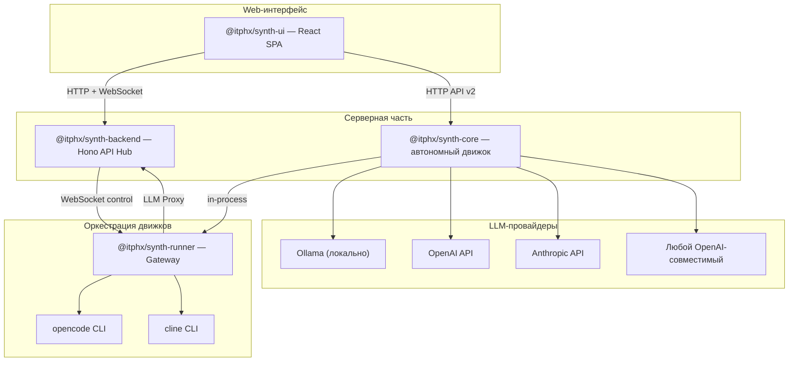

# Архитектура Synth

## Компоненты

Synth состоит из пяти пакетов в монорепозитории:

| Пакет | Назначение | Стек |
|-------|-----------|------|
| **@itphx/synth-shared** | Типы, интерфейсы, Zod-схемы, протоколы, конфигурация | TypeScript |
| **@itphx/synth-core** | Автономный движок: сессии, очередь, LLM-провайдеры, TSM, CLI, HTTP API v2 | TypeScript, Hono |
| **@itphx/synth-backend** | API Hub: OIDC, Runner Registry, LLM Proxy, RBAC, SessionEventBus | TypeScript, Hono |
| **@itphx/synth-ui** | React 19 SPA + админка (рендеринг по ролям) | TypeScript, React 19, Vite |
| **@itphx/synth-runner** | Gateway между бэкендом и движками (opencode, cline, synth-core) | TypeScript, Node.js |

## Архитектурная схема



## Сценарии развёртывания

### Облачный (командная работа)

```
synth-ui (браузеры сотрудников) ←→ synth-backend (:5000)
                                          ↕
                               synth-runner (K8s поды) ←→ opencode / cline
```

- Единый источник правды для сессий и истории
- Коллаборация: несколько пользователей в одной сессии
- Централизованный аудит всех LLM-запросов
- RBAC: роли ADMIN, USER, LEAD, AUDITOR
- API-ключи провайдеров хранятся только на бэкенде

### Локальный (один разработчик)

```
synth-ui (localhost) ←→ synth-core (:4300)
```

- Одна команда: `synth serve --api-key <key>`
- Прямой доступ к файловой системе
- Не требует бэкенда, Keycloak, Kubernetes

### Локальный + внешние движки

```
synth-core ←→ synthase-runner (in-process) ←→ opencode / cline
```

- `synth serve --api-key <key> --runner`
- In-process импорт @itphx/synth-runner
- LLM-запросы opencode/cline проксируются через core

### Гибридный (корпоративный)

```
synth-backend (корпоративный сервер) ←→ synth-ui (браузер)
                                          ↕
                             synth-core (ПК сотрудника, как раннер + клиент)
```

- Core на машине сотрудника — доступ к внутренним сервисам, VPN, файлам
- Сессии и аудит — централизованы на корпоративном бэкенде
- API-ключи провайдеров хранятся только на сервере

## Ключевые решения (AD)

| AD | Название | Статус |
|----|----------|--------|
| AD-022 | Единый TypeScript стек + Runner архитектура | ✅ Активно |
| AD-023 | Единая система конфигурации | ✅ Активно |
| AD-024 | Единая архитектура транспорта (EventHub) | ✅ Активно |

Подробнее — [AGENTS.md](../AGENTS.md).

## Структура монорепозитория

```
synth/
├── pnpm-workspace.yaml       # pnpm workspaces
├── tsconfig.base.json        # общий конфиг TypeScript
├── eslint.config.js          # линтер
├── .prettierrc               # форматтер
└── packages/
    ├── shared/   → @itphx/synth-shared
    ├── backend/  → @itphx/synth-backend
    ├── ui/       → @itphx/synth-ui
    ├── runner/   → @itphx/synth-runner
    └── core/     → @itphx/synth-core
```

## Модель «Runner»

Раннер — мост между бэкендом и движками:

```
synth-backend ◄── WebSocket (control) ──► synth-runner ◄── HTTP API ──► движок
                                           │
                                           ├── opencode (serve, :4100)
                                           ├── cline (headless, :4200)
                                           └── synth-core (serve, :4300)
```

**Два режима:**
- **Локальный:** пользователь запускает на своей машине. Прямой доступ к ФС.
- **Облачный:** K8s под, создаётся бэкендом при необходимости. Per-user модель.

**LLM Proxy:** раннер поднимает локальный OpenAI-совместимый эндпоинт (`localhost:9090/v1`). Движки думают, что общаются с OpenAI. Раннер пробрасывает запросы на бэкенд. Бэкенд аудирует и маршрутизирует на реального провайдера.

## Stateless модель движка

История сообщений — на бэкенде. Движок получает на вход:

- Историю сообщений
- Новое сообщение от пользователя
- Контекст (system prompt, проект, статус)

Это обеспечивает:

- Коллаборацию (несколько пользователей в одной сессии)
- Переключение движка без потери контекста
- Перезапуск движка без потери истории
- Очередь сообщений на бэкенде, доставка по одной
