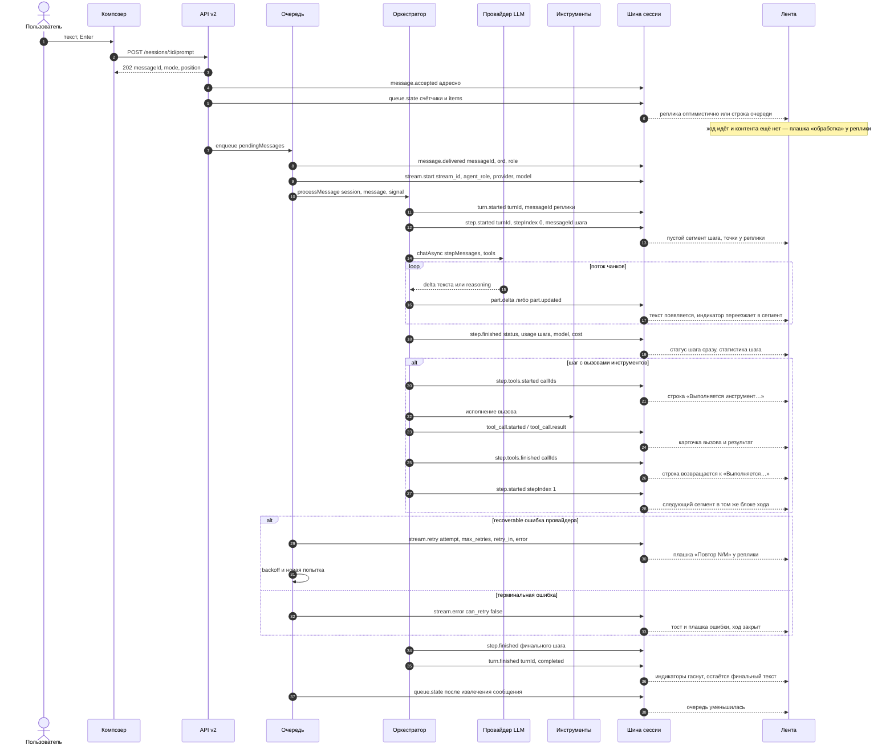
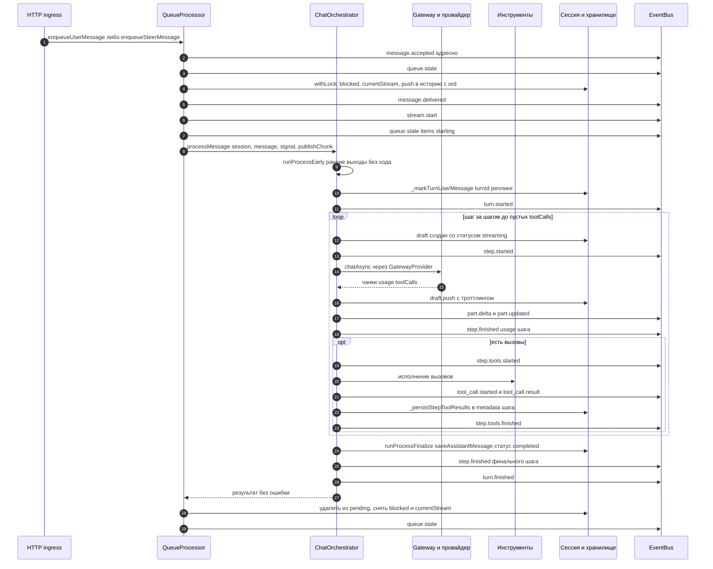
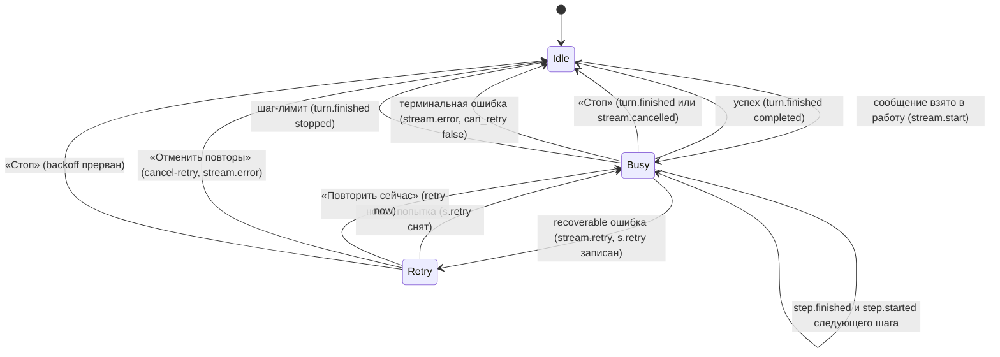
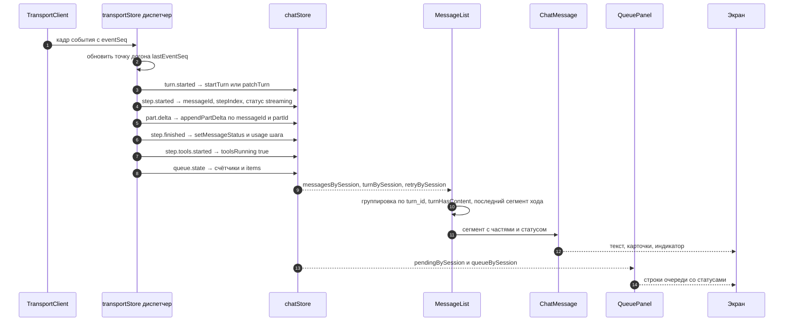
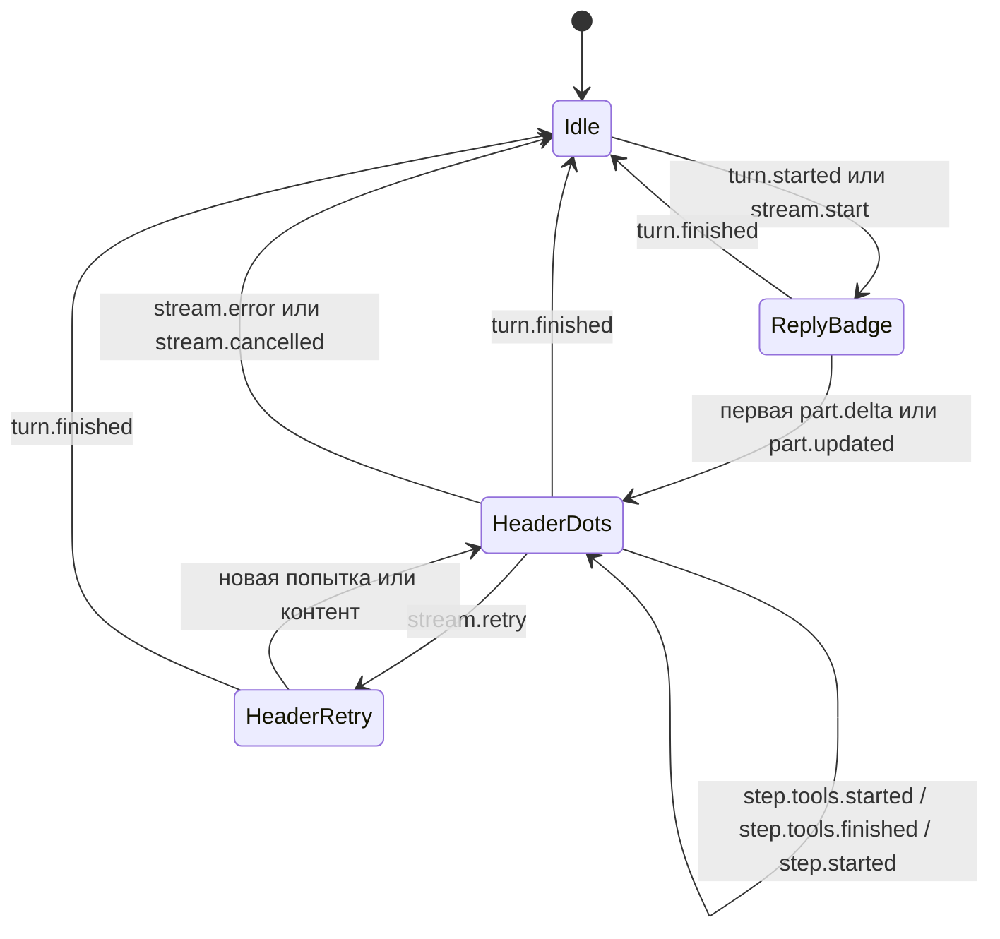
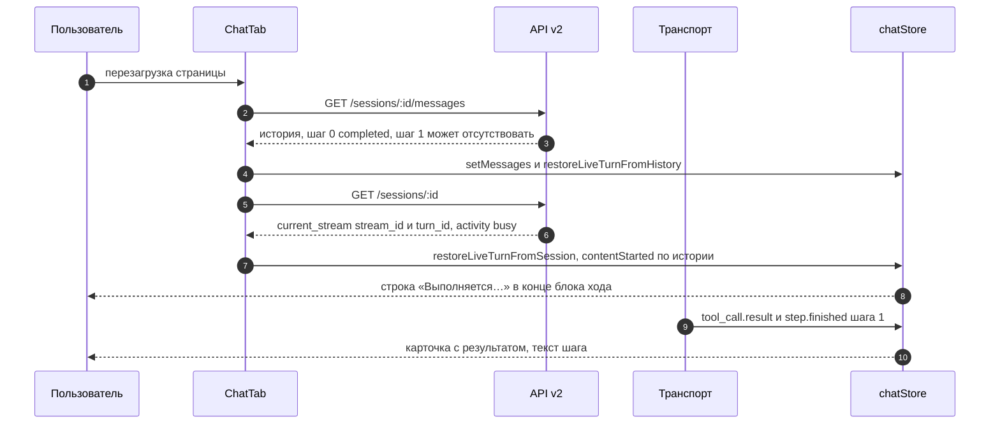
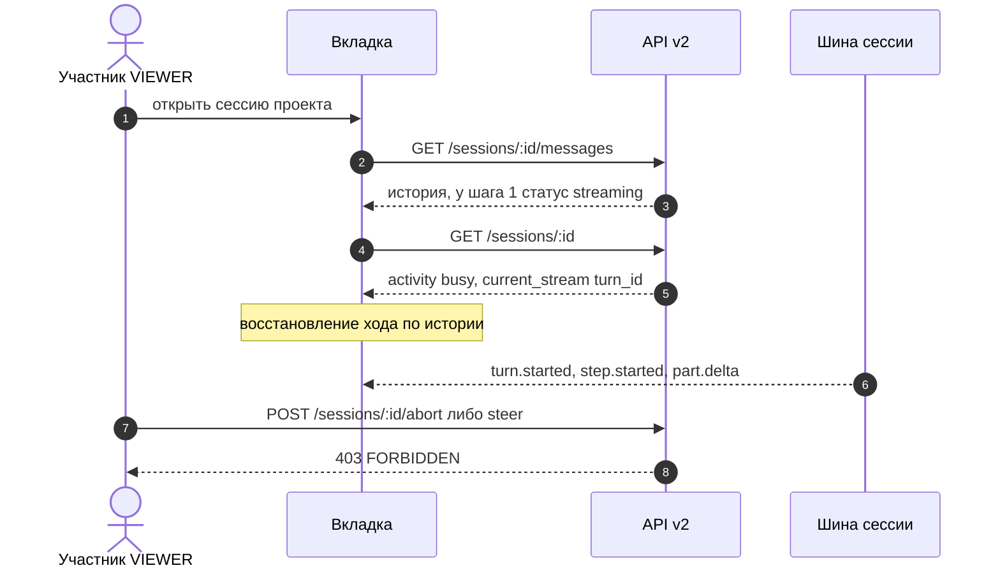
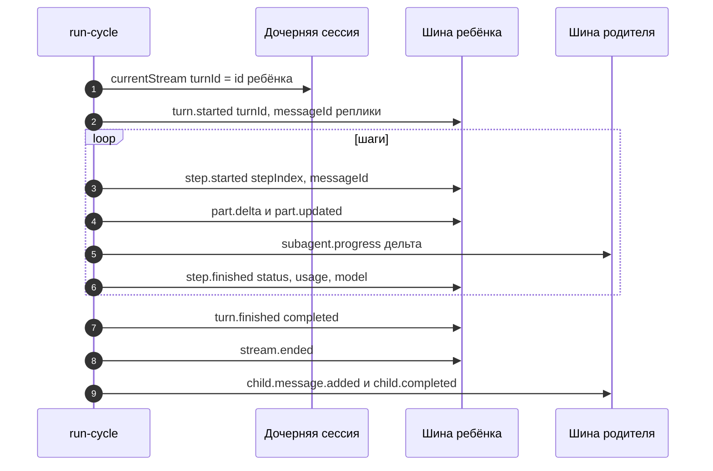
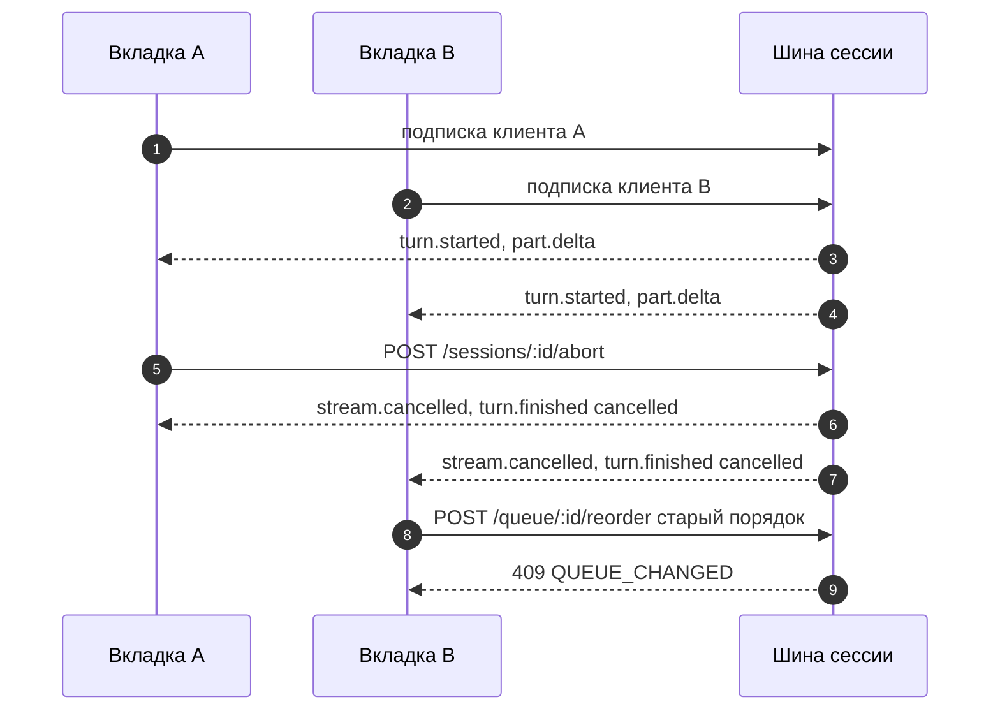

# Цикл обработки сообщений (поток сообщений v2)

> **Статус:** ✅ Актуально — соответствует [ADR-118](./arch_decisions/adr-118-message-stream-v2.md)
> (этапы 1–4 реализованы) и контракту [API_V2.md](./API_V2.md) §3.3/§5.5/§5.7.
> **Дата:** 2026-10-31
> **Кому:** разработчики ядра (`packages/core`), UI (`packages/ui`), авторы внешних интеграций
> (SDK, шлюзы, webhook-потребители, сторонние UI).
> **Правило:** поведение цикла (события, шаги, статусы, индикаторы, очередь) меняется только вместе
> с этим документом и тестами (инвариант 26 корневого [AGENTS.md](../AGENTS.md)).

## 1. Назначение и область

Документ описывает **один полный цикл обработки сообщения** в Synth — от нажатия «Отправить» до
терминального статуса хода и до того, что видит пользователь в ленте:

```text
приём (HTTP 202) → очередь → ход (turn) → шаги (step) → вызов LLM → инструменты
                 → события шины → состояние UI → индикаторы и лента
```

Что здесь есть:

- контракт приёма сообщения и режимы (`queue`/`steer`/`interrupt`);
- модель данных: `Session` → `Message` → `Part`, `activity`, элементы очереди;
- backend-декомпозиция по файлам, state machine хода/шага, инварианты;
- UI-декомпозиция: диспетчер событий, сторы, группировка сегментов, индикаторы, восстановление
  после reload;
- справочник событий, сценарии, чек-лист расширения и карта файлов.

Что здесь **нет** (сознательно, чтобы не дублировать):

- полный перечень HTTP-эндпоинтов и коды ошибок — [API_V2.md](./API_V2.md) §5.5/§5.6/§5.7;
- мотивация решения и альтернативы — [ADR-118](./arch_decisions/adr-118-message-stream-v2.md);
- транспорт (WS/SSE, `TransportClient`, `EventHub`) — [ADR-008](./arch_decisions/adr-008-websocket-events.md),
  [ADR-024](./arch_decisions/adr-024-eventhub-transport.md), [API_V2.md](./API_V2.md) §3;
- вложения и их гидратация — [ADR-115](./arch_decisions/adr-115-multimodal-input.md);
- фоновые прогоны — [ADR-111](./arch_decisions/adr-111-background-subagent-sessions.md),
  [ADR-113](./arch_decisions/adr-113-background-processes.md).

Ключевой контракт в коде — `packages/shared/src/types/message-stream.ts` (browser-safe: типы, payload'ы
событий, `PromptAcceptedResponse`, `MessageStatus`, `TurnStatus`, `InstanceCapabilities`).

## 2. Термины

| Термин | Что это | Где живёт |
|---|---|---|
| **Сообщение** (`Message`) | Запись истории сессии с частями и метаданными | `Session.messages[]`, `pendingMessages[]`, `steerInbox[]` |
| **Ход** (`Turn`, `turnId`) | От реплики пользователя до терминального статуса; объединяет шаги | `Message.turnId`, `current_stream.turn_id`, `turn.*` |
| **Шаг** (`stepIndex`) | **Один вызов LLM = одно assistant-сообщение**, 0-based внутри хода | `Message.stepIndex`, `step.*` |
| **Часть** (`part`) | Фрагмент сообщения: `text`/`reasoning`/`tool_use`/`tool_result`/медиа | `Message.parts[]`, `part.delta`/`part.updated` |
| **Стрим** (`streamId`) | Идентификатор попытки исполнения сообщения очереди (`stream-…`); **не** id хода | `current_stream.stream_id`, `metadata.stream_id`, payload'ы `stream.*` |
| **Очередь** (`pendingMessages`) | Сообщения, ждущие следующего хода (лимит 5) | `Session.pendingMessages` |
| **Вмешательство** (`steerInbox`) | Сообщения «в разрыв» активного хода (лимит 5 на ход); применяются на границе шага | `Session.steerInbox`, `metadata.steer` |
| **Попытка / повтор** | Номер вызова LLM для сообщения; recoverable-ошибка → backoff и повтор | `Session.retry`, `stream.retry` |
| **Активность** (`activity`) | Серверный статус сессии: `idle` / `busy` / `retry` | DTO сессии (`serializeSession`) |
| **`ord`** | Монотонный порядок **записи в историю**; выдаётся при материализации, не перенумеровывается | `Message.ord` |
| **`seq`** | **Позиционный** порядок в массиве истории (нормализуется при записи, `UNIQUE (session_id, seq)` в PG) | `Message.seq` |
| **`eventSeq`** | Монотонный номер события **в пределах инстанса** (сквозной по сессиям) — основа догона | `BusEvent.eventSeq` |
| **Финал** | Смена `Message.status` на терминальный, а **не** замена объекта | `step.finished` |

Два разных «статуса» — не путать:

- `Message.status` (`MessageStatus`) — **контракт хода**: `streaming` | `completed` | `cancelled` |
  `error`. Отдаётся в DTO верхнеуровневым полем `status`; определяет «живость» сегмента.
- `metadata.status` (`AssistantMessageStatus`, ADR-070) — **отображаемый** статус ответа:
  `completed` | `cancelled` | `stopped` | `error` | `limit` | `interrupted`. Живёт внутри `metadata`;
  по нему UI рисует префикс («Остановлено», «Лимит шагов» и т. п.).

## 3. Общая диаграмма



Что видит пользователь в каждый момент:

| Момент | В ленте | Индикатор |
|---|---|---|
| `202` | оптимистичная реплика (ход не идёт) либо строка очереди | нет |
| `turn.started`/`stream.start` | реплика уже есть; пустого пузыря ещё нет | плашка «обработка» у реплики |
| `step.started` | создан пустой сегмент шага (не рисуется, пока нет контента) | плашка у реплики |
| первая `part.delta`/`part.updated` | текст/рассуждения появляются | точки в шапке последнего блока активного хода (`processing-indicator`) |
| `step.finished` | текст шага зафиксирован, статистика шага | между шагами — строка «Выполняется…» |
| `step.tools.started` | карточки вызовов | строка «Выполняется инструмент…» |
| `step.tools.finished` | карточки с результатами | строка «Выполняется…» или следующий шаг |
| `turn.finished` | финальный текст хода | ничего |

## 4. Модель данных

### 4.1 `Session` (фрагмент, относящийся к циклу)

| Поле | Тип | Смысл |
|---|---|---|
| `currentStream` | `{streamId, turnId?, message, agentRole?, startedAt, cancelled}` | Живой стрим; `turnId` персистится (файловое хранилище — `current_stream.turn_id`, PostgreSQL — тот же JSONB) |
| `retry` | `{streamId, attempt, maxRetries, retryAt, error?}` | Персистентное состояние автоповтора (PG — jsonb-колонка `sessions.retry`, миграция `030`) |
| `status` | `{blocked?, blockedAt?, cancelRequested?, cancelRequestedAt?}` | `blocked` — сессия занята ходом/ждёт подтверждения; `cancelRequested` — персистентный флаг «Стоп» |
| `pendingMessages` | `Message[]` | Очередь; лимит `MAX_PENDING = 5` |
| `steerInbox` | `Message[]?` | Очередь вмешательств; лимит `MAX_STEER_INJECTIONS_PER_TURN = 5`; необязательное поле |

### 4.2 `Message`

| Поле | Тип | Примечание |
|---|---|---|
| `id` | `string` | Выделяется **при приёме**, стабилен; адресация мутаций — только по `id` |
| `seq` | `number` | Позиция в массиве истории (позиционная, перенумеровывается при вставке/удалении) |
| `ord` | `number?` | Монотонный порядок записи; `null` у сообщений до миграции |
| `role` | `user`/`assistant`/`system`/`tool` | — |
| `turnId` | `string?` | Ход; у реплики пользователя ставится оркестратором до `turn.started` |
| `stepIndex` | `number?` | Шаг внутри хода; у `user`-реплик не задан |
| `status` | `MessageStatus?` | `streaming` у черновика шага, терминальный — на `step.finished` |
| `parts` | `Part[]` | Источник рендера ленты |
| `content` | `string` | Строковая производная (БД/экспорт/поиск); медиа — плейсхолдеры |
| `reasoning` | `string?` | Текст рассуждений (подписи — на частях, ADR-117) |
| `toolCalls` | `Record<string, unknown>[]?` | Вызовы (у шага также `metadata.tool_results`) |
| `usage` | `TokenUsage?` | У финального сообщения хода — **сумма хода**; у сообщения шага — расход шага |
| `metadata` | `Record<string, unknown>?` | См. ниже |

Поля `metadata`, которые читает цикл:

| Ключ | Где | Смысл |
|---|---|---|
| `stream_id` | реплика, сообщение шага, `StreamInfo` | Связь сообщения с попыткой исполнения и элементом очереди |
| `tool_results` | **только** сообщение шага | Результаты вызовов этого шага (в DTO — `tool_calls`); в финале хода **не пишется** |
| `tool_chain` | сообщение шага | Признак «скрытый шаг» (шаг без видимого содержимого и без вызовов) |
| `subagents` | сообщение шага/финала | Агрегированная статистика саб-агентов (`task`) |
| `cost_usd` / `cost_currency` / `cost_breakdown` | сообщение | Стоимость по цене модели |
| `duration_ms` | сообщение | Длительность шага/хода |
| `status` | сообщение | Отображаемый статус (ADR-070), см. §2 |
| `step_limit_reached` | финал хода | Ход остановлен лимитом шагов |
| `usage_estimated` | сообщение | Расход оценён, а не получен от провайдера |
| `last_error` | user-реплика | Текст последней терминальной ошибки |
| `intermediate_text_blocks` | **legacy** | Тексты промежуточных итераций; для сообщений хода не пишется (миграция v3 вычищает) |
| `steer` / `interrupt` | user-реплика | Маркеры вмешательства/прерывания (ADR-104) |
| `type: background_run_result` | user-реплика | Уведомление о завершении фонового прогона (рисуется системным блоком) |

### 4.3 `Part`

| Поле | Тип | Примечание |
|---|---|---|
| `id` | `string` | Детерминированный: текст — `msg:text:<ordinal>`, reasoning — `msg:reasoning:<ordinal>`, вызов — `callId` провайдера, медиа — свой id |
| `type` | `text`/`reasoning`/`tool_use`/`tool_result`/`image`/`audio`/`video`/`file`/`session_reference` | — |
| `data` | `unknown` | Текст/сырой вызов провайдера/ссылка на blob (ADR-115) |
| `metadata` | `{signature?, redacted?}?` | Anthropic thinking (ADR-117), наружу не отдаётся |

Детерминированные `partId` — обязательное условие: персист выдаёт **те же** id, что стрим
(`withDeterministicPartIds` в `turn-events.ts`), иначе клиент получит две текстовые части одного
ответа и задвоит текст.

### 4.4 `activity` (DTO сессии)

| Значение | Поля | Когда |
|---|---|---|
| `{type:'idle'}` | — | Хода нет и сессия не заблокирована |
| `{type:'busy', turnId, streamId}` | `null`, если хода нет (например, `status.blocked` при ожидании подтверждения) | Есть `current_stream` **или** `status.blocked` |
| `{type:'retry', attempt, maxRetries, retryAt, error?, streamId}` | `attempt` — номер уже совершённых неудачных попыток, `retryAt` — ISO | Процессор ждёт backoff |

Приоритет: **retry > busy > idle**. Поле аддитивное; `retry` персистентен, поэтому после
reload/restart клиент видит «повтор», а не пустоту.

### 4.5 `queue.state.items`

```ts
{ id: string; status: 'queued' | 'starting' }
```

- `id` — идентификатор потока сообщения (`metadata.stream_id`); у обрабатываемого сообщения
  совпадает с `current_stream.stream_id`;
- `starting` — элемент взят в работу; `queueCounts` также добавляет `starting`-элемент, если живой
  стрим есть, а сообщения в очереди уже нет (например, после перезагрузки);
- **ни текста, ни автора** — очередь не утекает содержимое (замена удалённого `message.queued`).
  Текст сообщения очереди едет только в **адресном** `message.enqueued` (получатель — отправитель),
  в общий канал сессии не уходит; в ленте сообщение очереди (`delivery: 'queue'`) не показывается.

## 5. Backend-декомпозиция

### 5.1 Компоненты

| Компонент | Файл | Роль в цикле |
|---|---|---|
| HTTP ingress | `packages/core/src/server/routes/sessions.ts` | `POST /:id/prompt` → `202 {messageId, mode, position}`; `GET /:id/messages`; `GET /:id/messages/:messageId`; `POST /:id/abort` |
| Очередь | `packages/core/src/server/routes/queue.ts` | `clear`/`return`/`reorder`/`steer`/`resume`/`retry-now`/`cancel-retry` |
| Процессор очереди | `packages/core/src/queue/processor.ts` | `enqueueUserMessage`, `enqueueSteerMessage`, `reorderPendingMessages`, `requeueMessages`, `publishQueueState`, ретраи/backoff, «Стоп» |
| Оркестратор | `packages/core/src/engine/orchestrator.ts` | `turnId`, цикл шагов, `StreamMessageDraft`, `step.started/finished`, `step.tools.*`, `tool_call.*`, накопление `turnUsage` |
| Публикация событий хода | `packages/core/src/engine/orchestrator/turn-events.ts` | Единая точка `turn.*`/`step.*`/`part.*`, детерминированные `partId`, маппинг статусов |
| Финализация | `packages/core/src/engine/orchestrator/phases/process-finalize.ts` | «Финал = последний шаг», ветка отмены, фоллбеки, `step.finished` + `turn.finished` |
| Персист сообщений | `packages/core/src/engine/orchestrator/persistence.ts` | `saveAssistantMessage`, `keepContent`, `tool_results` только для шагов, `status` |
| Шина | `packages/core/src/events/bus.ts` | `recipient`, глобальный `eventSeq`, журнал (200 событий на сессию, 100 сессий), догон `since` |
| DTO | `packages/core/src/server/serialize.ts` | `activity`, `current_stream.turn_id`, `ord`/`turn_id`/`step_index`/`status`, `tool_calls` из `metadata.tool_results` |
| Хранилище (файлы) | `packages/core/src/storage/file-store.ts` | Персист `ord`/`turn_id`/`step_index`, `current_stream`, `retry` |
| Хранилище (PG) | `packages/storage-postgres/src/ports/sessions-mapping.ts` | То же для PostgreSQL; миграции `029` (`ord`/`turn_id`/`step_index`), `030` (`retry`) |
| Миграции данных | `packages/core/src/storage/migrations.ts`, `storage/instance-meta.ts` | v2 (`ord`/`turn_id`/`step_index`), v3 (`message-stream-v2-step-parts`), реестр `MIGRATIONS` |

### 5.2 Диаграмма



### 5.3 State machine хода, шага и активности



Пояснения:

- **Шаг.** Внутри `Busy` шаг живёт `step.started` → `part.*` → `step.finished`; при наличии
  вызовов между `step.finished` и `step.tools.finished` идёт **исполнение инструментов** (ход при
  этом остаётся `Busy`, `step.finished` означает лишь «вызов LLM завершён»).
- **«Стоп»** (`POST /:id/abort`): пишется персистентный `status.cancelRequested` под локом →
  `orchestrator.cancel(streamId)` (graceful: `stream.cancelled` + частичный ответ) →
  `queueManager.requestStop(id)` (будит backoff, абортит LLM-вызов). Очистку
  `pendingMessages`/`blocked`/`currentStream`/флага делает `QueueProcessor._handleStopRequest` и
  публикует `stream.cancelled` **ровно один раз** (если graceful-отмена уже сняла `currentStream`,
  дубля нет). Очередь очищается, кроме уведомлений фоновых прогонов
  (`metadata.type === 'background_run_result'`); неприменённые инъекции возвращаются в очередь
  (`steer.dropped` с `reason: 'aborted'`).
- **Отмена внутри шага** (оркестратор): `step.finished` со статусом `cancelled`, `stream.cancelled`,
  `turn.finished` `cancelled`; в истории — сообщение шага с `status: 'cancelled'` и частичным
  текстом (сохраняется всегда, даже пустым).
- **Ошибка.** Recoverable — `Session.retry` + `stream.retry`, ход не завершается; терминальная —
  `stream.error` (`can_retry: false`), извлечение из очереди, `turn.finished` `error`.
- **Шаг-лимит** (`AgentDefinition.maxSteps`): последний шаг идёт как обычный, но с
  `tool_choice: 'none'` и синтетической инструкцией «только текст»; запись шага затем
  **дополняется** финализацией (`keepContent: true`), `metadata.step_limit_reached = true`,
  `turn.finished` `stopped`.

### 5.4 Инварианты backend

1. **Финал = последний шаг.** Финальное сообщение хода несёт текст и reasoning только последнего
   шага; тексты прошлых шагов — в их сообщениях.
2. **`tool_results` — в сообщении своего шага.** В финале хода `metadata.tool_results` не пишется;
   DTO `tool_calls` финала пуст.
3. **`usage` финала = сумма хода** (`turnUsage`); `step.finished.usage` = расход **своего** шага;
   сумма шагов равна расходу хода.
4. **`step.finished` ≠ «шаг целиком завершён»**: это «вызов LLM завершён». Исполнение инструментов
   отмечают `step.tools.started`/`step.tools.finished` — ровно по одному разу на шаг с вызовами, на
   всех терминальных путях (обычное завершение, отмена, `deny`-цикл, шаг-лимит); `turn.finished` —
   после `step.tools.finished`.
5. **`eventSeq` глобальный** в пределах инстанса (сквозной по сессиям); инстансный канал
   (`pipeline.run.*`) номера не получает и в журнал сессий не попадает.
6. **Мутации сообщений — только по `id`** (`PATCH/DELETE /messages/:sessionId/:messageId`, `batch {
   messageIds }`); фоллбека на позицию нет.
7. **Очередь без текста.** `queue.state` и `items` несут только счётчики/id/состояния; текст
   сообщения в канал сессии не публикуется.
8. **`turn_id` в `current_stream`** — метка активного хода; персистится, чтобы после reload/restart
   опознать тот же ход (`stream_id` — не id хода).
9. **`ord` иммутабелен после выдачи** (`prepareMessageForUpdate` берёт `ord` исходной записи);
   выдача сериализуется per-session локом.
10. **Шаг-лимит дополняет запись шага**, а не создаёт вторую с тем же текстом (`keepContent`
    сохраняет текст/части/`toolCalls`, обновляя только терминальные поля).
11. **Миграция v3 идемпотентна**: `planMessageStepPartsCleanup` считает план, повторный прогон —
    no-op; маркер `migrations.message-stream-v2-step-parts` в runtime-настройках.
12. **Ранние выходы не открывают ход**: `runProcessEarly` (системные сообщения, `/`-команды,
    micro-first) возвращает результат до `turnId`, поэтому `turn.*` для них не публикуются.
13. **«Стоп» прерывает только активный ход.** `POST /:id/abort` не останавливает фоновую работу:
    фоновые процессы и фоновые (detached/background) саб-агенты продолжают работу —
    `BackgroundRunService.stopBySession` из роута **не** вызывается (метод остаётся публичным API
    сервиса). Блокирующий `task` останавливается сам: abort сигнала тула → `run-cycle` видит
    `isAborted` → `finishAborted`. Явная остановка фоновой работы — `POST /processes/:id/stop`
    (фоновый процесс/саб-агент) и «Стоп» её собственной сессии (`POST /sessions/<child>/abort`).
14. **Дочерняя сессия публикует ход так же, как основная.** `run-cycle` ставит `currentStream`
    ребёнка (`turnId` = id дочерней сессии) и публикует `turn.started`/`step.started`/
    `part.delta`/`part.updated`/`step.finished`/`turn.finished` **в канал ребёнка**. Отличия:
    `step.tools.*` у ребёнка нет (карточки вызовов идут `part.updated`, результаты — с сообщением
    шага), а `subagent.progress`/`subagent.retry`/`tool_call.*` идут в канал **родителя** (парт
    `task` по `parent_call_id`).

## 6. UI-декомпозиция

### 6.1 Компоненты и поток

| Слой | Файл | Роль |
|---|---|---|
| Транспорт | `packages/ui/src/lib/api/transport.ts` | WS `/ws/events` с фоллбеком на SSE; `messageModel` и `since` в URL |
| Диспетчер | `packages/ui/src/stores/transportStore.ts` | Разбор кадров в сторы; `restoreLiveTurnFromSession`/`restoreLiveTurnFromHistory`; точечная догрузка |
| Сторы | `packages/ui/src/stores/chatStore.ts` | `messagesBySession`, `partsBySession`, `turnBySession`, `retryBySession`, `pendingBySession`, `queueBySession` |
| Сведение частей | `packages/ui/src/lib/messageParts.ts` | `buildPartsView`, `resolveLiveParts`, `turnHasContent` |
| Список | `packages/ui/src/components/chat/MessageList.tsx` | Группировка по `turn_id`, `turn-block`, последний сегмент хода (точки в шапке, retry), точки у реплики |
| Сообщение | `packages/ui/src/components/chat/ChatMessage.tsx` | Сегмент: шапка с точками, части, live-статистика, «В фон», `RetryStatus` |
| Очередь | `packages/ui/src/components/chat/QueuePanel.tsx` | Строки очереди, статусы `queued|starting`, steer, DnD |
| Экран сессии | `packages/ui/src/components/chat/ChatTab.tsx` | Загрузка истории, восстановление хода, рефреш очереди, мутации по `id` |



### 6.2 State machine индикатора



Условия показа (по коду):

| Состояние | Что рисуется | Условие |
|---|---|---|
| `ReplyBadge` | `processing-indicator` в шапке последней **человеческой** user-реплики | `turn.status === 'streaming'` и `!turnHasContent(...)`; последняя реплика хода — по `turn_id`. Плашки автоповтора у реплики нет |
| `HeaderDots` | `processing-indicator` в шапке **последнего визуального блока активного хода** (у первого сегмента группы, вместо времени) | `turn.status === 'streaming'`, `group.turnId === turn.turnId`, группа — последняя assistant-группа этого `turn_id` (шаг может быть уже `completed` — идут инструменты/пауза) |
| `HeaderRetry` | `RetryStatus` («Повтор N/M», таймер, «Повторить сейчас»/«Отменить») **внизу ответа** последнего сегмента хода | `retry.streamId === turn.streamId` и сегмент — последний |
| `Idle` | ничего | ход не `streaming` |

**Единый предикат «контент хода был»** — `turnHasContent(messages, turn, fallback?)`: флаг
`turn.contentStarted` **или** непустой контент assistant-сообщения этого хода. Его используют
восстановление хода и плашка у реплики; собственных предикатов в этих местах не заводить. Флаг
поднимает и вызов инструмента (`tool_call.started`).

### 6.3 Группировка, сегменты и части

- Сообщения сортируются по **`ord`** (`sortMessagesByOrd`): у обоих есть `ord` — по нему, tie-break
  по `id`; `ord` только у одного — по времени материализации; нет ни `ord`, ни `created_at` —
  живое сообщение в конце. **Не смешивать `ord` и `index`**: `index` — позиция в массиве DTO, только
  для существующих потребителей.
- **Вклинивание** (принято в ход, но ещё не записано в историю — `ord` не выдан,
  маркер `steerPending`) идёт в **хвост** ленты: после всех записанных и **перед** живым сегментом
  хода (живое остаётся последним). Между собой — по `created_at` (время постановки).
  Маркер снимается на `message.delivered` (сообщение записано в историю — `ord` выдан).
- Группы строятся по `turn_id`: `key = turn:<turnId>:<id>` либо `msg:<id>`; группа из нескольких
  assistant-сегментов рисуется одним блоком (`data-testid="turn-block"`, `bare`-сегменты,
  разделители между шагами).
- Ход, разорванный user-репликой (в т.ч. уведомлением `metadata.type === 'background_run_result'`),
  даёт **вторую** группу с тем же `turn_id` — отдельный визуальный блок со своей шапкой. Внутри
  блока шапка «агент · модель · время» одна — у первого сегмента (`showHeader={first}`).
- Части: `buildPartsView(dto, live, fallback)` мержит DTO и live по `id` (live приоритетнее).
  `resolveLiveParts` при `isLive` отдаёт live-части, а на терминальном статусе — **текст и reasoning
  только из DTO**, tool-части мержатся с DTO по `callId` (иначе «застрявший» текст прошлого шага
  попал бы в блок хода, а карточка инструмента потеряла бы результат).
- Дедуп — по `id` сообщения и по `{messageId, partId}` части: `part.delta`/`part.updated` — upsert,
  повторная доставка не задваивает текст.
- `step.finished` ставит терминальный статус **синхронно** (шаг закрыт), затем
  выполняется `mergeHistory` (сверка содержимого с историей). Live-части при этом не снимаются;
  ход продолжается — точки остаются в шапке последнего сегмента.
- Пустой живой сегмент (новый шаг до первого токена) рендерится **только заголовком** — без тела —
  если он **первый** в группе (точки в его шапке); не-первый не рендерится вовсе (шапка блока уже
  несёт точки). Условие: `message.status === 'streaming'` и (`turn.contentStarted === true` или
  `turn.toolsRunning === true`); на самом первом шаге индикатор живёт у реплики и сегмент скрыт
  (двух индикаторов одновременно нет).

### 6.4 Восстановление после reload / открытия сессии

Порядок (по коду `restoreLiveTurnFromSession`):

1. `GET /sessions/:id/messages` → **мерж** с живым состоянием (`mergeServerMessages`, тот же
   свод, что у `mergeHistory`) → `restoreLiveTurnFromHistory` — по сообщению со
   `status: 'streaming'`. Снимок сервера не заменяет стор: иначе при переключении вкладок посреди хода
   показанный контент затирался более старым снимком (ход «мелькал» и пропадал до следующего чанка).
   Пока ход активен, более богатые известные `content`/`parts` сохраняются.
2. `GET /sessions/:id` → `activity` и `current_stream`.
3. `turnId` = `current_stream.turn_id` → `activity.turnId` → (при живом стриме/активном ходе)
   `turn_id` последнего сообщения истории → legacy `current_stream.stream_id` / `activity.streamId`.
   Если `turnId` не выводится совсем (например, только `status.blocked`) — границы хода
   восстанавливаются из истории (`restoreLiveTurnFromHistory`).
4. `streamId` = `current_stream.stream_id` → `activity.streamId` — нужен для сопоставления
   `stream.retry`; агент/модель/провайдер — для шапки хода.
5. `contentStarted` = `turnHasContent(...)` по истории (иначе индикатор «идёт» стоял бы у реплики,
   хотя ответ уже виден).
6. **Снимок живого шага** (`current_stream.live`, ADR-118 §5) применяется **до** расчёта границ:
   сообщение шага создаётся/дополняется (`content`, `reasoning`, `parts`) и части кладутся в
   live-состояние (`upsertPart`) — открытая посреди хода сессия показывает всё до момента запроса,
   не дожидаясь следующей дельты. Снимок серверный (in-memory), привязан к `streamId` и снимается на
   `step.finished`; завершённое сообщение снимком не «воскрешается».
7. `activity.type === 'retry'` → `setStreamRetry` из `attempt`/`maxRetries`/`retryAt`/`error`
   (событие `stream.retry` после reload уже не придёт).
8. Признаки активного хода: `current_stream`, `status.blocked`, `activity.type: 'busy'|'retry'`;
   `idle`/отсутствие `activity` активным ходом не считается.
9. Очередь: `pending_messages` → строки очереди; если есть активный стрим, **первый** элемент
   (он же `starting`) не показывается — он уже в ленте.
10. **Дочерняя сессия** (`session_origin: 'subagent'`): сохранённый `currentStream` ребёнка несёт
   `turnId = <childSessionId>` (так его пишет `run-cycle`, а при detach — `detachable.ts`), и
   `activity` ребёнка = `busy`; `contentStarted` считается по истории, как у основной. Восстановление
   идёт тем же путём (`restoreLiveTurnFromSession`), а UI дополнительно включает read-only-режим
   (композер скрыт, внизу `SubagentResumeBar`). Признак активного прогона снимается только **своим**
   `streamId` — чужой маркер (новый прогон) не перетирается.

`turn.toolsRunning` **не персистится**: после reload во время длинного инструмента точки в шапке
последнего сегмента появятся со следующего `step.tools.started` (флаг поднимает и `step.started`).
После **перезагрузки страницы** live-части начинают накапливаться заново, а live приоритетнее DTO по
совпадающему `partId` — до `step.finished` (и мержа истории) в сегменте виден прирост после reload;
полный текст шага даёт `step.finished`/история. При **переключении вкладок** живое состояние стора не
сбрасывается и сводится со снимком, поэтому отображение не зависит от прихода очередного чанка.

### 6.5 Очередь

- `QueuePanel` рисует `pendingBySession` (текст и автор — из своей оптимистичной строки/истории,
  сервер их в событиях не присылает) и `queueBySession` (счётчики, `stalled`).
- Статус элемента — `queued`/`starting` (`queue-status-<i>`); `starting` — сообщение уже в работе.
- DnD → `POST /queue/:sessionId/reorder {ids}`: 400 — невалидный список, **409 `QUEUE_CHANGED`** —
  очередь на сервере изменилась: клиент перечитывает её (`refreshQueueFromApi`); успех →
  `reorderPending` локально + сервер публикует `queue.state`.
- «В разрыв» (`queue-steer-<i>`) — только при активном ходе; ответы 409 `NO_ACTIVE_TURN` /
  `CONFLICT`, 429 `STEER_LIMIT_EXCEEDED` обрабатываются рефрешем очереди; применённое сообщение
  приходит `message.delivered`.

**Очередь и лента — разные вещи.** Разделение по `delivery` события `message.enqueued`:

| `delivery` | Что это | Лента | Панель очереди |
|---|---|---|---|
| `queue` | сообщение ждёт следующего хода | **не показывается** | строка очереди, статус `queued`/`starting`, счётчик, действия (DnD, «в разрыв», возврат, удаление) |
| `steer` | вклинивание в текущий ход | показывается **сразу** (до материализации), обычной репликой без пометок | — |

- Лента получает только `delivery: 'steer'` из **адресного** события `message.enqueued` (снимок уже
  обфусцирован, ADR-036) — вклинивание видно сразу, не дожидаясь материализации.
  `message.delivered` **примиряет** его по `id`: проставляет `ord`/`turn_id` и снимает маркер
  ожидания (`steerPending`) — второго пузыря нет.
- Уведомление о завершении фоновой работы (`metadata.type === 'background_run_result'`) идёт тем же
  путём (`enqueueSteerMessage` → `message.enqueued` со `delivery: 'steer'`), поэтому оно появляется
  в ленте в момент финиша фонового прогона, а не на границе шага.
- **Досева очереди в ленту нет.** После перезагрузки события `message.enqueued` не придут, и очередь
  из `pending_messages` в ленту не добавляется: она видна только в панели очереди.
- **Уборка неразрешённых вклиниваний.** Если вклинивание вернулось в обычную очередь (ход
  закончился до границы шага) — оно убирается из ленты (сверка очереди с сервером,
  `reconcileQueueFromApi`); на терминале хода (`turn.finished`, `stream.cancelled`/`stream.error`)
  неразрешённые вклинивания сессии снимаются. Применённое вклинивание приходит с
  `message.delivered` (маркер снят) и остаётся в ленте как обычная реплика.
- Отправка «в разрыв» из UI — кнопка **«Вклинить»** в панели очереди
  (`POST /queue/:sessionId/steer`); тумблер в композере не возвращается.

### 6.6 Точечная догрузка `message.delivered`

Если сообщения с таким `id` в сторе нет — диспетчер запрашивает **одно** сообщение
(`GET /sessions/:id/messages/:messageId`) и вставляет его с `ord`/`role`/`author`; ошибка или 404 —
фоллбек на `mergeHistory` (полная сверка истории). Если сообщение уже есть — обновляются только
`ord`/`role`/`author` (без перезагрузки истории) и снимается маркер ожидания (`steerPending`).
Если событие несёт `turnId` — он же проставляется в `turn_id` (привязка сообщения к ходу).

### 6.7 Инварианты UI

1. **Один индикатор одновременно.** Либо точки-«обработка» у реплики, либо точки в шапке
   шапки последнего блока активного хода — но не два сразу. Строки активности (`turn-activity`) в ленте нет.
2. **Не смешивать `ord` и `index`** при сортировке; `ord` — единственный «настоящий» порядок ленты.
3. **Не воскрешать финальные сообщения**: `part.delta`/`part.updated` к сообщению с терминальным
   статусом игнорируются (исключение — `allowTerminal` для вызова инструмента, который приходит уже
   после `step.finished`).
4. **Не создавать фантомы без активного хода**: `ensureLiveMessage` возвращает `undefined`, если
   активного хода нет (опоздавшее событие прошлого хода), и не принимает событие другого `turnId`.
5. **Текст и reasoning — только из DTO на финале**, tool-части — мерж live (см. §6.3).
6. **Опоздавшее событие старого хода не гасит текущий**: закрытие сегментов идёт с `onlyTurnId`.
7. **Терминальное событие закрывает ход**, даже если `turn.finished` потерян (`closeTurnOnTerminal`),
   иначе композер навсегда остаётся в режиме «в очередь + Стоп».

## 7. Справочник событий

Канал по умолчанию — канал сессии (`EventBus.publish(sessionId, …)`); `message.accepted` и
`message.enqueued` — **адресные** (`recipient`): у `message.accepted` — отправитель, у
`message.enqueued` — отправитель сообщения, а если его нет (уведомление о завершении фоновой
работы) — владелец сессии (`owner_id ?? user_id`; в standalone это `local`). Владельца
определить не удалось — `message.enqueued` **не публикуется** (fail-closed: снимок содержит
текст, утечка в общий канал сессии недопустима — сообщение появится по `message.delivered`).
В standalone пользователь один, поэтому событие видно всем локальным клиентам — известное
ограничение ADR-118.

| Событие | Канал / адресат | Payload (`data`) | Когда публикуется | Реакция UI |
|---|---|---|---|---|
| `message.accepted` | адресно | `messageId`, `mode` (`queue`/`steer`/`interrupt`), `position` | Приём сообщения в очередь/инъекцию (только `role: user`) | `queue` — строка очереди по id; `steer`/`interrupt` — сверка очереди с сервером |
| `message.enqueued` | адресно | `messageId`, `delivery` (`queue`/`steer`), `position`, `message` — **снимок** сообщения (`id`/`role`/`author?`/`content`/`parts?`/`metadata?`/`created_at`; **без `ord`**, уже обфусцирован) | Постановка сообщения в очередь/очередь вмешательств (ровно один раз на сообщение; при отказе постановки события нет) | `delivery: 'steer'` — вклинивание в ленте сразу, обычной репликой без пометок (дедуп по `id`); `message.delivered` затем примиряет его (`ord`/`turn_id`). `delivery: 'queue'` — только панель очереди, в ленте не показывается |
| `queue.state` | канал сессии | `pendingCount`, `steerCount`, `items?` (`{id, status}`) | Постановка/извлечение, старт хода, отмена, reorder, возврат сообщений | Счётчики и статусы элементов; панель очереди |
| `message.delivered` | канал сессии | `messageId`, `ord`, `role`, `author?`, `principal?`, `turnId?` (ход сообщения — аддитивно) | Материализация записи в истории (в т. ч. применённая инъекция) | Известное сообщение обновляется (`ord`/`role`/автор/`turn_id`), пометка «в очереди» снимается; иначе точечная догрузка |
| `stream.start` | канал сессии | `stream_id`, `agent_role`, `provider`, `model`, `metadata?` для системных | Сообщение взято в работу (первая попытка) | Открывает/дополняет ход, снимает ретрай и плашку ошибки |
| `turn.started` | канал сессии | `turnId`, `messageId` (реплика) | Начало хода | Границы хода, сброс `stream.retry`/финальной ошибки |
| `turn.finished` | канал сессии | `turnId`, `status` (`completed`/`cancelled`/`error`/`stopped`) | Терминальный статус хода | Закрывает ход и оставшиеся `streaming`-сегменты **этого** хода, снимает полосу подтверждений |
| `step.started` | канал сессии | `turnId`, `stepIndex`, `messageId` | Перед вызовом LLM (сообщение шага уже создано) | Создаёт/адресует assistant-сообщение шага, закрывает предыдущие сегменты хода |
| `step.finished` | канал сессии | `turnId`, `stepIndex`, `messageId`, `status` (`streaming`/`completed`/`cancelled`/`error`), `usage?`, `provider?`, `model?`, `costUsd?`, `costCurrency?`, `agentRole?`, `attachments?`, `debugInfo?`, `timings?` | Ответ LLM получен, сообщение шага закрыто | Терминальный статус сразу + статистика шага; затем `mergeHistory` |
| `step.tools.started` | канал сессии | `turnId`, `stepIndex`, `messageId`, `callIds` | Перед исполнением вызовов шага (ровно один раз) | `toolsRunning` → строка «Выполняется инструмент…» |
| `step.tools.finished` | канал сессии | те же поля | После записи `metadata.tool_results` (в т. ч. отмена/deny/шаг-лимит) | `toolsRunning: false` |
| `part.delta` | канал сессии | `messageId`, `partId`, `field` (`text`/`raw`), `delta` | Поток текста от провайдера | Upsert части, первый контент поднимает `contentStarted` |
| `part.updated` | канал сессии | `messageId`, `partId`, `part` | Reasoning целиком; часть вызова инструмента | Upsert части (reasoning/карточка вызова) |
| `tool_call.started` | канал сессии | `stream_id`, `session_id`, `call_id`, `name`, `arguments`, `iteration`, `parent_call_id?` | Перед исполнением вызова (в т. ч. вызовы саб-агента) | Карточка вызова в live-части |
| `tool_call.result` | канал сессии | `stream_id`, `session_id`, `call_id`, `name`, `result`, `iteration` | После исполнения вызова (в т. ч. ошибки/отказ политики) | Результат в карточке |
| `tool_call.loop` | канал сессии | `stream_id`, `session_id`, `iteration`, `total_tool_calls` | Конец итерации инструментов | Диагностика/прогресс |
| `stream.retry` | канал сессии | `stream_id`, `attempt`, `max_retries`, `retry_in`, `error` | Recoverable-ошибка, перед backoff | Плашка «Повтор N/M» у реплики |
| `stream.error` | канал сессии | `stream_id`, `error`, `error_type`, `retry_count`, `can_retry` | Терминальная ошибка (или отмена повторов) | Тост + плашка ошибки, закрытие хода |
| `stream.cancelled` | канал сессии | `stream_id`, `content`, `status` | «Стоп» (ровно одно событие на отмену) | Закрывает живое сообщение/ход, снимает подтверждения |
| `queue.stalled` | канал сессии | `pending_count` | Очередь осталась после выхода процессора | Панель «обработка остановлена» |
| `steer.dropped` | канал сессии | `reason` (`limit`/`aborted`/`turn_ended`), `code?`, `limit?`, `dropped_count`, `error`, `i18n` | Лимит инъекций, «Стоп», конец хода | Тост, сообщение не применено (или возвращено в очередь) |
| `permission.asked` / `permission.replied` / `permission.hold` | канал сессии | `approval_id`, `tool`, `principal`, `turn_id`, `digest`, `reason?` | Инструмент требует подтверждения / ответ / «остановить таймер» | Полоса подтверждения над композером |
| `user_question.asked` / `answered` / `cancelled` | канал сессии | `question_id`, `questions[]`, `created_at`, `expires_at?`, `turn_id?`, `tool_call_id?`, `agent_role?` | Агент задал вопрос (ADR-112) | Док вопроса, тост, непрочитанное |
| `question.asked` | канал сессии | `message`, `agent_role`, `pending_count` | Очередь «зависла» после хода (legacy-смысл, не ADR-112) | Панель ожидания |
| `message.added` | канал сессии | `id`, `message_index`, `role`, усечённый `content` (до 500 символов), `model`, `provider`, `agent_role`, `reasoning`, `tool_calls`, `metadata` | Пока публикуется (остаток ADR-118, совместимость) | Совместимость; новая реализация опирается на `message.delivered` + `part.*` |
| `child.*` / `process.*` | канал сессии-владельца | `child_session_id`, `process_id`, `state`, `background_run_id`, `description`… | Фоновые прогоны (ADR-111/ADR-113) | Вкладка «Процессы», тосты, системный блок результата |

> **Дочерняя сессия (саб-агент).** `turn.started`, `turn.finished`, `step.started`, `step.finished`,
> `part.delta`, `part.updated` и `stream.ended` публикуются и в канал **ребёнка** (`turnId` = id
> дочерней сессии, `stepIndex` = номер итерации, `messageId` — id своего assistant-сообщения шага),
> поэтому открытая дочерняя вкладка показывает живой ход так же, как основная. Отличия:
> `step.tools.started`/`step.tools.finished` у ребёнка **не публикуются** (карточка вызова приходит
> `part.updated` с `toolCallPart`, результаты — с сообщением шага), а `subagent.progress`,
> `subagent.retry`, `tool_call.started`/`tool_call.result` идут в канал **родителя** (парт `task`
> по `parent_call_id`). Ввод ребёнку (`POST /sessions/<child>/prompt`) материализуется его
> `message.delivered`, лимит инъекций — его `steer.dropped`.

Удалённые без dual-emit (ядро их **не** публикует): `stream.chunk`, `stream.usage`, `stream.done`,
`stream.interrupted`, `message.injected`, `message.queued`. UI принимает кадры старого протокола как
совместимость со старым ядром (гибрид с другой версией). Гейт `messageModel`: клиент сверяет
`GET /api/v2/meta` до подключения, несовпадение — **fail-closed** (WS close `1008`, SSE `426`).

Догон: событие получает `eventSeq` (глобальный, монотонный в пределах инстанса) и попадает в журнал
сессии (кольцевой буфер 200 событий, до 100 сессий). Клиент передаёт `since`/`Last-Event-ID` =
максимум применённых номеров; сервер отдаёт журнал строго после него.

## 8. Сценарии

### 8.1 Обычный ход (без инструментов)

1. Композер → `POST /prompt` → `202`; в ленте реплика (или строка очереди, если ход уже шёл).
2. `message.accepted` (строка очереди), `queue.state`. Порядок между HTTP-ответом и событием не
   гарантирован — клиент схлопывает строку по `messageId`.
3. Сообщение взято в работу: `message.delivered` (`ord`) → `stream.start` (`stream_id`) →
   `turn.started` → `step.started` (шаг 0).
4. Чанки → `part.delta`; первый текст переносит индикатор из реплики в сегмент.
5. Ответ без вызовов инструментов: цикл завершается, и **финализация** публикует единственный
   `step.finished` (шаг 0) и `turn.finished completed` — то же сообщение шага становится финалом
   хода (смена статуса, без второй записи).
6. `queue.state` после извлечения сообщения из очереди.

Пользователь: плашка «обработка» → печатающийся текст → финальный текст и статистика; ничего лишнего.

### 8.2 Ход с инструментами

1. `step.started` → текст/вызовы → `step.finished completed`.
2. `step.tools.started` → строка «Выполняется инструмент…».
3. `tool_call.started`/`tool_call.result` → карточка вызова с результатом.
4. `step.tools.finished` → строка возвращается к «Выполняется…».
5. `step.started` следующего шага (текст ответа) → `step.finished` → `turn.finished`.

Пользователь: текст шага, карточки инструментов в **своём** шаге, затем ответ; карточки не
дублируются в конце хода.

### 8.3 Многошаговый ход

Каждый шаг — отдельное assistant-сообщение (`stepIndex` 0,1,2…), все с одним `turn_id`.
`MessageList` склеивает их в один блок (`turn-block`), шапка — только у первого сегмента; между
сегментами тонкие разделители. Финальное сообщение несёт текст **последнего** шага, `usage` —
сумму хода.

### 8.4 Reload во время длинного инструмента



Пользователь: не пустая лента, а блок хода с уже полученным текстом и точками в шапке последнего сегмента.
`toolsRunning` после reload неизвестен → текст строки «Выполняется…» (не «Выполняется инструмент…»).

### 8.5 Автоповтор провайдера (recoverable ошибка)

1. LLM-вызов падает с recoverable типом (`isLlmErrorRecoverable`).
2. `Session.retry` записывается под локом (`attempt`, `maxRetries` = `LLM_MAX_ATTEMPTS` = 3,
   `retryAt`), публикуется `stream.retry` (`retry_in` — 5 с / 15 с / 30 с по попыткам 1–3).
3. UI: плашка «Повтор N/M» у реплики; при `activity` после reload — та же плашка.
4. Новая попытка: `retry` снимается, ход остаётся `busy`; успех → обычный финал, исчерпание
   попыток → `stream.error` (`can_retry: false`) и терминальный статус.

Кнопки: «Повторить сейчас» (`retry-now` — будит backoff), «Отменить» (`cancel-retry` —
извлечение из очереди + `stream.error`).

### 8.6 «Стоп»

1. `POST /sessions/:id/abort` → `200 {status:'aborted'}`; персистентный `cancelRequested`.
2. Graceful-отмена: оркестратор публикует `stream.cancelled`, сохраняет частичный ответ
   (`status: 'cancelled'`), `step.finished cancelled`, `turn.finished cancelled`.
3. `QueueProcessor._handleStopRequest`: очередь очищается (кроме уведомлений фоновых прогонов),
   `blocked`/`currentStream`/`retry`/флаг снимаются, `queue.state`; `stream.cancelled` — только если
   graceful-ветка его не опубликовала.
4. Неприменённые инъекции возвращаются в очередь: `dropSteerInjections({reason:'aborted'})` →
   сообщения попадают в `pendingMessages` (`queue.state`, автостарта нет — ход остановил
   пользователь), `steer.dropped reason: aborted` публикуется только по фактически потерянным
   (переполнение очереди). Фоновые прогоны (фоновые саб-агенты и процессы) **не** останавливаются —
   «Стоп» прерывает только активный ход (решение 2026-10-31, ADR-111 §detach п. 10); их
   останавливают явно (`POST /processes/:id/stop`, «Стоп» дочерней сессии). Блокирующий `task`
   останавливается сам: abort сигнала тула → `run-cycle` → `finishAborted`.

Пользователь: ответ помечен «Остановлено», индикаторы гаснут, композер снова готов к прямой отправке.

### 8.7 Шаг-лимит

1. `toolIteration + 1 >= maxSteps` → шаг идёт с `toolChoice: 'none'` и инструкцией «только текст».
2. Если провайдер всё же вернул вызовы — они **не исполняются**, модель получает парные
   `tool.disabled_by_step_limit` (пары `assistant(tool_calls) → tool` не рвутся).
3. `step.finished` закрывает шаг; финализация **дополняет** его запись (`keepContent`), ставит
   `metadata.step_limit_reached = true` и, при пустом ответе, текст `session.steps_limit`.
4. `turn.finished stopped`.

Пользователь: один сегмент с отчётом, без дубля «шаг + финал».

### 8.8 `steer` (вмешательство в ход)

1. `POST /prompt {mode:'steer'}` (или `mode:'interrupt'`) при активном ходе → сообщение в
   `steerInbox`, `202 {position: null}`; `message.accepted` (`mode: steer`/`interrupt`),
   `queue.state` (`steerCount`).
2. Оркестратор вычитывает `steerInbox` на **границе шага** (`applySteerInjections`): сообщение
   персистится, приходит `message.delivered` (с `ord`), лимит — 5 на ход; внутри шага инъекция не
   действует.
3. `interrupt` дополнительно обрывает текущую генерацию: частичный ответ сохраняется сообщением
   шага (`cancelled`), ход продолжается.
4. «Стоп» снимает неприменённые инъекции, возвращая их в очередь.

Пользователь: реплика появляется в ленте с бейджем вмешательства (или прерывания), ответ
продолжается в том же блоке хода; прочие участники видят её с автором.

### 8.9 Уведомление о фоновом процессе

1. Фоновый прогон завершился → ядро формирует user-сообщение с `metadata.type =
   'background_run_result'` и конвертом для модели (`<process …>`/`<subagent …>`).
2. Сообщение ставится в очередь (`requeueMessages`/доставка), публикуется `queue.state`; при старте
   хода — обычные `message.delivered`/`stream.start`.
3. UI рисует **системный блок** (`Notice` вариант `process`) с карточкой результата, а не
   user-пузырь; ход, разорванный таким уведомлением, даёт вторую группу с тем же `turn_id` без
   повторной шапки.
4. «Стоп» такие сообщения не удаляет — они ждут следующего хода.

### 8.10 Открытие сессии посреди хода

1. Загрузка истории (`GET /messages`) → восстановление хода по `streaming`-сообщению.
2. `GET /sessions/:id` → `current_stream`/`activity`/`status.blocked` → `turnId`, `streamId`,
   `contentStarted`, при `retry` — плашка повтора.
3. `pending_messages` → строки очереди (первый элемент, совпадающий со стартом, не дублируется).
4. Дальнейшие события доезжают штатно; `since` при реконнекте закрывает разрыв журналом.

Пользователь: видит текущий ход, актуальную очередь и корректный индикатор без «пустой ленты».

### 8.11 Открытие сессии, где идёт ответ другому участнику (shared project)



1. История и `activity` доступны любому, кто видит сессию (владелец, участник проекта любой роли,
   `LEAD`/`ADMIN`) — `GET`/`HEAD` это уровень `read`.
2. Live-события получает **подписанный** клиент: подписка строится при подключении по
   `listSessions({ userId })` (свои сессии; в standalone пользователь один — все локальные) плюс
   дочерние и созданные через роуты (`session.created`, `child.*`). Фильтра по роли на шине нет:
   подписанный `VIEWER` видит поток так же, как `EDITOR`. Для сессии **чужого** владельца в
   shared-проекте live-события могут не прийти до перезагрузки — это ограничение подписки «по
   владельцу» (инвариант 18), а не правовое.
3. Права разводит граница: `accessKindOf` (`GET`/`HEAD` → `read`, остальное → `write`). `VIEWER`
   читает, но «Стоп», steer, правки сообщений и очереди получают `403 FORBIDDEN`; `EDITOR`/`OWNER`
   (а также `LEAD`/`ADMIN`) — разрешены.
4. **GAP:** UI чата пока не скрывает «Стоп»/steer по роли — `VIEWER` видит кнопки и получает `403`
   (в отличие от «Пайплайнов», где `canEditProjectContent` гасит действия). Сервер при этом
   корректен.

Код: `packages/core/src/server/session-access-guard.ts`, `packages/backend/src/events/hub.ts`.

### 8.12 Открытие дочерней сессии во время работы (blocking и detached)



1. Пока прогон идёт, у ребёнка стоит `currentStream` (`turnId` = id ребёнка, `agentRole` =
   тип саб-агента) — открытая вкладка ребёнка видит индикатор и восстанавливает ход после reload
   (§6.4). Маркер снимается только своим `streamId`.
2. События шага: `turn.started` → `step.started` → `part.delta` (текст, без троттлинга) /
   `part.updated` (reasoning, карточка вызова) → `step.finished` (usage/модель/стоимость шага) →
   `turn.finished` (терминальный статус) → `stream.ended`. `step.tools.*` у ребёнка нет.
3. **Detached** (`POST /sessions/:id/background`): прогон получает собственный `streamId`,
   `currentStream` ребёнка переписывается на него, в канал родителя уходит `process.detached` (не
   `process.started`); живой ход ребёнка продолжается как обычно, «Стоп» родителя его больше не
   трогает.
4. `isReadOnly`: сессия `session_origin: 'subagent'` в UI — только чтение (`isReadOnly = isSubagent`):
   действия с сообщениями, панель очереди, полосы подтверждений/вопросов и композер скрыты, внизу —
   `SubagentResumeBar` («Продолжить» после ошибки/отмены).
5. `subagent.progress` (дельты, троттлинг ~300 мс, лимит `SUBAGENT_PROGRESS_MAX_CHARS`) идёт
   **родителю** — в парт `task` по `parent_call_id`; в канал ребёнка он не дублируется.
6. **Снимок живого шага ребёнка.** `run-cycle` пишет `current_stream.live` и для дочерней
   сессии (`setLiveStreamSnapshot(childSessionId, …)`, `streamId` = стрим прогона, `stepIndex` =
   итерация): открытая вкладка саб-агента видит текущий шаг целиком, не дожидаясь дельт.
   Снимается на `step.finished` ребёнка (общий `publishStepFinished`).
7. **Карточка саб-агента в основной сессии.** Синхронный (`background: false`) и фоновый прогоны
   выглядят одинаково: Prompt, reasoning/промежуточный текст (из `subagent.progress`), шаги ребёнка
   (`tool_call.*` с `parent_call_id`) и Response. Пока прогон идёт, источник — **живые данные** части
   `task` (результата ещё нет), после завершения — `result.metadata` (`reasoning_blocks`/
   `intermediate_text_blocks`/`tool_calls`/`final_content`). Иначе у синхронного до завершения был
   виден только Prompt.

Код: `packages/core/src/engine/tools/task/run-cycle.ts`, `task/child-session.ts`,
`task/detachable.ts`.

### 8.13 Steer, попавший на конец хода

1. `POST /prompt {mode:'steer'}` при активном ходе принят (`202 {position: null}`), сообщение лежит
   в `steerInbox`; `message.accepted`, `queue.state` (`steerCount`).
2. Границы шага больше не будет (шаг был финальным) → финализация вызывает
   `dropSteerInjections({reason:'turn_ended'})`: очередь снимается атомарно (`clearSteerInbox`),
   сообщения **возвращаются** в `pendingMessages` (`requeueMessages`: маркеры `steer`/`interrupt`
   снимаются, новый `stream_id`, `queue.state`).
3. Обычное завершение → `requeueSteerMessages(..., {autostart: true})`: поднимается процессор, и
   сообщение становится **новым ходом**. «Стоп» → `autostart: false`: сообщение ждёт в очереди.
4. `steer.dropped` публикуется только по фактически потерянным (переполнение `MAX_PENDING = 5`),
   причины `turn_ended`/`aborted`; возврат в очередь отмечается логом (события нет — UI видит
   `queue.state`).

Пользователь: отправленная «в разрыв» реплика не исчезает — либо сразу начинается новый ход, либо
она стоит строкой в очереди.

Код: `packages/core/src/engine/steering/apply.ts`,
`engine/orchestrator/phases/process-finalize.ts`, `queue/processor.ts`.

### 8.14 Критическая ошибка провайдера (non-recoverable)

1. `classifyLlmError` даёт невосстановимый тип (`auth`, `model_not_found`, `context_length`,
   `provider_not_found`, …) либо `isLlmErrorRecoverable` = `false` — **ретраев нет**,
   `stream.retry` не публикуется.
2. Оркестратор: `step.finished` со статусом `error` (тот же `messageId` шага) → `turn.finished error`;
   `handleLlmFailure` пишет assistant-сообщение об ошибке (текст + `i18n`-ключ ADR-041) и
   `metadata.last_error` в user-реплику.
3. Процессор: сообщение извлекается из очереди, `blocked`/`currentStream`/`retry` снимаются,
   публикуется `stream.error {can_retry: false, error_type, retry_count}`, затем `queue.state`.
4. UI: `StreamErrorPanel` над композером с локализованным текстом (`context_length` — «контекстное
   окно превышено», `auth` — «ошибка авторизации», иначе общий + сырой текст в подсказке); кнопка
   «Повторить» показывается только для recoverable-типов (`resolveStreamErrorAction`).

Код: `packages/core/src/engine/orchestrator/errors.ts`, `queue/processor.ts`,
`packages/ui/src/components/chat/StreamErrorPanel.tsx`.

### 8.15 Ошибки в дочерней сессии

1. Recoverable внутри ребёнка → `subagent.retry` в канал родителя; паузы **ничего** не пишут в
   историю ребёнка (мусорных сообщений нет).
2. Терминально после retry: в историю ребёнка — сообщение `role: error`
   (`task.subagent_exec_error` / `..._after_retries`), `turn.finished error`, `currentStream`
   снимается, хук `agent_failed`. В открытой дочерней сессии ошибка видна этим сообщением и полосой
   `SubagentResumeBar` («Продолжить»), а не основной плашкой `StreamErrorPanel`.
3. Родителю: `task_result` с `<status>error</status>` и `isError: true` — для модели родителя это
   обычный `tool_result`, ход **продолжается** (другой инструмент или текстовый ответ).
4. Отмена (`isAborted`) → `finishAborted`: частичный текст итерации — assistant-сообщение
   `cancelled` (`partial: true`), маркер `task.stopped_by_user` (роль `info`), `turn.finished
   cancelled`; родителю `<status>stopped_by_user</status>` + `<partial_output>`.
5. Жёсткий сбой вне штатных веток: `turn.finished error`, снятие `currentStream`, `stream.ended`,
   `agent_failed`; родитель получает `isError`-результат.
6. Во всех терминальных путях остаток очереди инъекций ребёнка возвращается в его `pendingMessages`
   (`dropChildSteerInjections`).

Код: `engine/tools/task/run-cycle.ts`, `task/child-session.ts`.

### 8.16 Отказ в доступе к инструменту (permission deny)

1. `PermissionEvaluator` вернул `deny`: ролевой (`matchedRule: 'role.unavailable'`), отказ
   пользователя (ask → deny) или запрет политики.
2. Ход **не** обрывается: модель получает обычный `tool_result` с причиной и на следующей итерации
   может выбрать другой инструмент (ADR-070 §2.9.1).
3. Предохранитель: 5 одинаковых deny-вызовов подряд (`MAX_REPEATED_DENY_COUNT`, ключ «тул +
   аргументы») завершают ход; если содержательного ответа так и не было — фоллбек
   `session.denied_blocked`, статус `stopped`.
4. `ask`: `permission.asked` (полоса `PermissionRequestBar`, обратный отсчёт `ask_timeout_ms`).
   Ответ — WS-кадр `permission_reply` или HTTP `POST /sessions/:id/permissions/:approvalId`
   (`{action, once?, turn_id?, digest?}`); `once: true` — разово, `once: false` — «разрешить в
   сессии»; `hold` — только снять таймер, реестр не трогает.
5. Саб-агент ведёт себя так же (`subagentDenied` — лишь фоллбек `task.stopped_by_deny`); ask
   публикуется в канал **родителя** (подтверждает человек основной сессии).

Код: `engine/permission/{evaluator,approval}.ts`, `engine/orchestrator.ts`,
`server/routes/sessions.ts`.

### 8.17 Отказ шлюза безопасности (LLM Gateway)

| Что | Реакция | Провайдер | Ретрай | Что видно |
|---|---|---|---|---|
| Входной guard блокирует (секреты/инъекция) | контент-предупреждение `gateway.input_blocked`, аудит `blocked` | **не вызывается** | нет | текст-предупреждение в ленте, ход `completed` |
| Rate limit шлюза (`RateLimiter`: 60/мин на пользователя, 120/мин на провайдера) | `gateway.rate_limit_warning` (usage 0), аудит `rate_limited` | не вызывается | **нет** | текст-предупреждение, ход `completed` |
| Вето фильтра плагина (`llmFilters`, фаза `pre_request`) | предупреждение с причиной, аудит `plugin_filter` | не вызывается | нет | текст-предупреждение |
| Выходной guard | **только аудит** (секреты/ссылки в ответе) | — | — | ответ не меняется и не блокируется |

Отличие от 8.20: все четыре пути **не** бросают исключение, поэтому `stream.retry`/`stream.error`
нет — ход закрывается обычным `step.finished completed` + `turn.finished completed`.

Код: `engine/gateway/gateway-provider.ts`, `input-guard.ts`, `output-guard.ts`, `rate-limiter.ts`.

### 8.18 Таймаут и `hold` подтверждения инструмента

1. `permission.asked` несёт `ask_timeout_ms` (конфиг `permission.askTimeoutMs`, по умолчанию
   300 000 мс; `0` — без авто-отклонения); полоса считает обратный отсчёт от `askedAt + timeoutMs`.
2. Ответа нет → `waitForDecision` резолвится `{approved:false, timeout:true}` → `tool_result`
   «approval timed out» (`permission.ask_timeout`); ход продолжается по deny-семантике (8.16).
3. `hold` (кнопка «Остановить таймер» или `POST /permissions/:approvalId {action:'hold'}`) —
   публикуется `permission.hold`, таймер снят, запрос ждёт ответа бесконечно.
4. «Стоп» сессии резолвит ожидание как `cancelled` (без повторного `permission.asked`), причина в
   результате тула — `permission.ask_cancelled`; инструмент не висит до своего таймаута.
5. Что видно: тул/детали/счётчик ожидающих/таймер в полосе; при недоставленном ответе — тост
   `permission.bar.replyFailed`, полоса **остаётся** (иначе пользователь думает, что ответил).
6. Нет подписчиков канала — подтверждение не публикуется вовсе: инструмент сразу получает отказ
   (`noSubscribers`), ход не висит.

Код: `engine/permission/approval.ts`, `packages/ui/src/components/chat/PermissionRequestBar.tsx`.

### 8.19 Лимит инъекций (шестая)

1. `POST /prompt {mode:'steer'|'interrupt'}` при заполненном `steerInbox` (предел
   `MAX_STEER_INJECTIONS_PER_TURN = 5`) → `429 STEER_LIMIT_EXCEEDED`
   (`code: 'STEER_LIMIT_EXCEEDED'`), сообщение **не** принято.
2. Если лимит выявлен на границе шага (`takeSteerMessages` вернул лишние) — публикуется
   `steer.dropped {reason:'limit', code, limit, dropped_count, error, i18n}`.
3. UI: тост с текстом лимита; реплики в ленте нет (она не создана), `queue.state` не меняется.

Код: `queue/processor.ts` (`enqueueSteerMessage`), `engine/steering/apply.ts`,
`shared/src/types/steering.ts`.

### 8.20 Gateway rate limit и провайдерский 429 — два разных пути

| | Лимит шлюза (свой счётчик) | Ответ провайдера 429 |
|---|---|---|
| Где | `RateLimiter` внутри `GatewayProvider` | HTTP-ответ модели |
| Форма | контент-предупреждение, `usage = 0` | исключение `RateLimitError`/текст |
| Тип | — (не ошибка хода) | `classifyLlmError` → `rate_limit` (recoverable) |
| Ретрай | нет | `stream.retry` + backoff 5/15/30 с, до `LLM_MAX_ATTEMPTS = 3` |
| Исчерпание | — | `stream.error {can_retry:false, error_type:'rate_limit'}` |
| В ленте | текст-предупреждение, ход `completed` | плашка «Повтор N/M», затем ошибка |

Практический смысл: предупреждение шлюза означает «запрос не ушёл провайдеру», и повторять его
бессмысленно — лимит считается локально; 429 провайдера — «попробуй позже», поэтому идёт backoff.

Код: `engine/gateway/gateway-provider.ts`, `engine/gateway/rate-limiter.ts`, `engine/llm-error.ts`.

### 8.21 Context length exceeded

1. Провайдер отвечает ошибкой переполнения (класс `ContextLengthExceededError` либо текст
   `context_length`) → тип `context_length`, **non-recoverable**: повторов нет.
2. `step.finished error` → `turn.finished error`; assistant-сообщение об ошибке несёт `i18n`-ключ
   `router.context_length_exceeded`.
3. `stream.error {error_type:'context_length', can_retry:false}`, сообщение извлекается из очереди.
4. UI показывает дружелюбный текст `chat.streamError.contextLength` и **не** показывает сырое
   сообщение провайдера (оно бесполезно пользователю); кнопки «Повторить» нет.

Код: `engine/orchestrator/errors.ts`, `packages/ui/src/components/chat/StreamErrorPanel.tsx`.

### 8.22 Шаг-лимит (`maxSteps`)

1. `stepLimitStep = iteration + 1 >= maxSteps` (нумерация как в оригинальной механике: `maxSteps: N`
   даёт N−1 рабочих шагов + шаг-лимит, `maxSteps: 1` — сразу отчёт).
2. Шаг идёт с `toolChoice: 'none'`; инструкция «отвечай только текстом» вставляется
   assistant-сообщением в запрос и **в историю не пишется**.
3. «Непослушные» вызовы не исполняются, но и не выбрасываются: на каждый пишется парный
   `tool`-результат `tool.disabled_by_step_limit` (+ `tool_call.result`), пары `tool_use`/`tool_result`
   не рвутся.
4. `step.finished` закрывает шаг; финализация **дополняет** его запись (`keepContent`), ставит
   `metadata.step_limit_reached = true` и `step_limit`, при пустом ответе — текст
   `session.steps_limit`, `metadata.status: 'limit'`.
5. `turn.finished stopped`. Дубля «шаг + финал» в ленте нет.

Код: `engine/llm/max-steps.ts`, `engine/orchestrator.ts`,
`engine/orchestrator/phases/process-finalize.ts`.

### 8.23 Исполнитель недоступен (split-режим)

1. `execution.mode = remote`: команды идут по HTTP в пул исполнителей; пул недоступен или ни у
   одного адреса нет нужного бинаря → `ExecutionError` с кодом `EUNREACHABLE` / `EDEPENDENCY`
   (`dependency_missing`, текст «в пуле: N из M»).
2. Локального фоллбека **нет** — fail-closed: тихий возврат в inline запрещён (оператор запросил
   удалённое исполнение).
3. Ошибка тула → `tool_result` с `isError` (`tool.exec_error` или текст причины): карточка тула
   красная, ход **продолжается**, модель выбирает другой путь или объясняет пользователю.
4. MCP: неудачный discovery повторяется через 15 с (снимок состава пула), вызовы отдают ошибку так
   же; фоновый запуск без поддержки → `EBACKGROUND` → `background_unsupported`.

Код: `execution/remote.ts`, `execution/ports/execution-port.ts`,
`packages/executor/src/client.ts`.

### 8.24 Деградация хранилища / БД

1. Недоступность БД **при старте** → файловый фоллбек строго read-only (`storage.degradedMode:
   fallback-file`): сервис поднимается, `/health` → `degraded` (+ блок `storage`, `restartRequired`),
   `/ready` остаётся `ready` (деградация ≠ неготовность).
2. HTTP: guard `createStorageDegradedGuard` — не-`ADMIN` получает `503 STORAGE_DEGRADED`; `ADMIN` —
   только чтение (`GET`/`HEAD`), мутации → `503 STORAGE_DEGRADED_READONLY` (кроме allowlist
   ремонтных путей). Контур `/api/v2/processes` в деградации **не монтируется** (404).
3. Ошибки конфигурации/зависимостей и «схема новее» — fail-closed: фоллбек не применяется, старт
   падает.
4. **Текущий ход.** Фоллбек подключается только при старте: если БД пропала во время хода, подмены
   «на лету» нет. Ошибка записи всплывает как внутренняя — процессор чистит `pendingMessages`/
   `blocked`/`currentStream`/`retry` и публикует `stream.error {error_type:'internal',
   can_retry:false}`; ход закрывается, авто-восстановления нет — нужен рестарт.
5. Авто-возврата к БД нет (контекст хранилища замкнут в deps): состояние и подсказка — в
   `GET /api/v2/storage/status`.

Код: `server/storage-degraded.ts`, `storage/storage-context.ts`, `queue/processor.ts`.

### 8.25 Две вкладки или два клиента



- Каждое подключение — отдельный клиент тех же подписок: события получают **оба**; `message.accepted`
  адресное (`recipient` = отправитель), поэтому строку очереди сразу видит только отправитель (в
  standalone пользователь один — видно всем).
- «Стоп» в одной вкладке закрывает ход в обеих: терминальные события идут в канал сессии.
- DnD/перестановка по устаревшему списку во второй → `409 QUEUE_CHANGED` (состав `ids` не совпал);
  клиент перечитывает очередь. Steer: `409 NO_ACTIVE_TURN` / `CONFLICT`, `429 STEER_LIMIT_EXCEEDED`.
- Локальные оптимистичные строки не «спорят» с сервером: они схлопываются по `messageId`.

Код: `queue/processor.ts` (`reorderPendingMessages`), `server/routes/queue.ts`,
`packages/ui/src/components/chat/QueuePanel.tsx`.

### 8.26 Reload и «Стоп» во время backoff

1. Backoff: `Session.retry {streamId, attempt, maxRetries, retryAt}` + `stream.retry`; `activity` =
   `retry` (приоритет выше `busy`).
2. Reload: `GET /sessions/:id` → `activity.type === 'retry'` → `setStreamRetry` (attempt/maxRetries/
   `retryAt`/error) — событие `stream.retry` после перезагрузки уже не придёт. Оставшееся время
   считается как `max(0, retryAt − now)`: у просроченного `retryAt` — `0`, а не отрицательное
   значение.
3. «Стоп» в backoff: персистентный `cancelRequested` + `requestStop` будят таймер;
   `_handleStopRequest` снимает `retry`, `pendingMessages`, `blocked`, `currentStream` и публикует
   `stream.cancelled` (ровно один раз). Плашка повтора гаснет.
4. «Повторить сейчас» (`retry-now`) — будит backoff немедленно; «Отменить» (`cancel-retry`) —
   `stream.error {error_type:'retry_cancelled', can_retry:false}`.

Код: `queue/processor.ts`, `packages/ui/src/stores/transportStore.ts`
(`restoreLiveTurnFromSession`).

### 8.27 Уведомление о фоне после конца хода

1. Фоновая работа завершилась → user-сообщение с `metadata.type = 'background_run_result'` и
   конвертом `<process …>`/`<subagent …>`; ставится в очередь, публикуется `queue.state`.
2. Ход уже закончился (в том числе его остановил пользователь) — сообщение **остаётся** в
   `pendingMessages`: «Стоп» чистит очередь, кроме уведомлений фоновых прогонов. Автостарта нет.
3. Следующий ход (отправка пользователя, resume очереди, старт процессора) забирает его обычным
   `message.delivered` + `stream.start`.
4. В ленте — системный блок (`Notice` вариант `process`) с карточкой результата, а не user-пузырь;
   ход, разорванный уведомлением, даёт вторую группу с тем же `turn_id` без повторной шапки.

Код: `queue/processor.ts` (`_handleStopRequest`), `engine/background/service.ts`
(`buildSubagentNotification`), `packages/ui/src/components/chat/background-notice.ts`.

### 8.28 Вложения: native / derive / отброс

1. Гидратация — **на границе отправки провайдеру**: **native** (модальность модели известна и
   принимается, контейнер поддержан протоколом) → **derive** (aux-модель семейства из
   `attachments.modalityModels`; в диалог идёт текст `[family: name]`, кэш `attachments/.derived`)
   → **drop** (`reason: modality` / `limit` / `unavailable`).
2. Для аудио при заданной aux-модели derive идёт **раньше** native (голосовые контейнеры слишком
   разнородны). Модальности **неизвестны** — фильтра нет: вложение уходит как есть (тихая потеря
   запрещена).
3. Отброс: модели уходит блок `[ATTACHMENTS NOT DELIVERED]` (`prompts/system/ATTACHMENTS_DROPPED.{ru,en}.md`,
   `{model}`/`{modalities}`), а при `attachments.workspaceFallback` копия кладётся в
   `<workspace>/attachments/` (атомарно, без перезаписи, дедуп по содержимому, иначе суффикс
   `-2`, `-3`) и модели сообщается **относительный** путь. История сообщения не меняется.
4. Лимиты: загрузка — `attachments.maxFilesPerMessage`/`maxBytesPerFile`/`maxBytesPerSession`
   (`413`/`415`, одна точка — `AttachmentService.upload`); на отправку — `maxBytesPerMessage` и
   `MAX_ATTACHMENT_BASE64_BYTES` (отбрасываются самые старые).
5. Модель сессии не меняется никогда; расход aux-вызова виден в аналитике отдельно; `stripMetadata`
   (EXIF/IPTC/XMP) срезается только при отправке — в blob лежит оригинал.

Код: `engine/attachments/{hydrate,derive,materialize}.ts`,
`packages/ui/src/components/chat/attachments`.

### 8.29 Пустой ответ и doom loop

1. Пустой ответ без deny-блокировок → фоллбек `session.empty_response`, `metadata.status: 'error'`,
   `turn.finished error`.
2. Пустой ответ при deny-блокировках → `session.denied_blocked`, `metadata.status: 'stopped'`,
   `turn.finished stopped`.
3. Doom loop (одинаковые легальные вызовы) и исчерпание лимита шагов прекращают цикл; 5 одинаковых
   deny-вызовов подряд — тоже (8.16).
4. Саб-агент: пустой финальный ответ → `task.empty_response` (прогон считается успешным),
   зацикливание на deny → фоллбек `task.stopped_by_deny`.

Код: `engine/orchestrator/phases/process-finalize.ts`,
`engine/orchestrator/persistence.ts` (`resolveAssistantStatus`), `task/run-cycle.ts`.

### 8.30 Вопрос пользователю посреди хода (`question`, ADR-112)

1. Тул `question` → `user_question.asked` в канал сессии (`question_id`, `questions[]`,
   `created_at`, `expires_at?`, `turn_id`, `tool_call_id`, `agent_role`).
2. Ход **встаёт на паузу** до ответа: сессия остаётся `busy`, индикатор не гаснет; в UI — док
   `QuestionDock` над композером (сворачивание, точки-сегменты, шаг проверки «вопрос → ответ»,
   обратный отсчёт по `expiresAt`), тост — только если сессия не активна.
3. Ответ → `user_question.answered` → `tool_result` с ответами → ход продолжается той же итерацией
   (новый ход не открывается).
4. Таймаут (если `timeout` задан, минимум 5 мин) или «Стоп» → `user_question.cancelled`
   (`timeout`/`aborted`); тул получает отказ, ход продолжается.
5. Саб-агентам `question` запрещён (deny), в plan-режиме разрешён.

Код: `engine/question/service.ts`, `engine/tools/question.ts`,
`packages/ui/src/components/chat/QuestionDock.tsx`.

### 8.31 Перенос или форк сессии во время хода

1. Перенос: `PATCH /sessions/:id {projectId}` или агентские `project_create`/`project_attach` →
   `session.moved` (старый/новый `project_id`, при снятии привязки worktree — `worktree_detached`).
2. UI по `session.moved` обновляет `project_id` в сторе, список проектов и дерево Files; лента и
   границы хода **не** пересобираются.
3. `pendingMessages`, `steerInbox`, `currentStream` (`turn_id`) и `ord` сообщений не меняются — ход
   продолжается на новой привязке. Рабочий каталог и периметр инструментов зафиксированы на старте
   хода (`runProcessSetup` → `_resolveWorkingDir`), поэтому смена workspace/worktree применяется
   со **следующего** хода; в DTO сессии новые `project_id`/`worktree` видны сразу.
4. Форк (`forkSession`, ADR-033): новый id, история копируется, но живой ход **не** переносится
   (у форка нет `currentStream`); `turn_id` в истории остаётся историческим, стрим — только у
   исходной сессии.

Код: `server/routes/sessions.ts`, `engine/tools/project-manage.ts`,
`packages/ui/src/stores/transportStore.ts` (`session.moved`).

### 8.32 Мульти-реплика (PROP-105)

1. Ход живёт в том процессе, куда пришёл `POST /prompt`: `QueueProcessorManager` — per-process,
   `SessionManager.withLock` — in-process. Значение состояния (сессия, очередь, `currentStream`,
   `retry`) — в общем сторе (файлы/PG).
2. Клиент другой реплики live-события **не получает** (шина событий in-process): он видит историю
   по `GET /sessions/:id/messages` и `activity` в `GET /sessions/:id` после перезагрузки; в ленте —
   то, что успело сохраниться.
3. «Стоп» на другой реплике: персистентный `status.cancelRequested` пишется в общий стор, а
   процесс-владелец проверяет флаг на границах цикла и завершает ход (`stream.cancelled`,
   `turn.finished cancelled`). Живой `orchestrator.cancel` в чужом процессе недоступен — отмена
   приходит «на границе», не мгновенно.
4. Очередь и лимиты — остаток PROP-105: claim-семантика очереди, межпроцессный лок сессии, общие
   rate limit'ы не реализованы; поэтому чарт держит `backend.replicaCount: 1`, а multi-replica
   требует sticky-сессий.

Код: `queue/processor.ts`, `sessions/manager.ts`, `docs/arch_decisions/prop-105-multi-replica-coordination.md`.

## 9. Расширение и изменение

### 9.1 Новый тип части

1. `PartType` в `packages/shared/src/types/message.ts` (+ DTO/сериализация, если нужны данные).
2. Рендер — `buildPartsView` (`packages/ui/src/lib/messageParts.ts`) и `ChatMessage`; для медиа —
   `MessageAttachments` (ADR-115).
3. Если часть приходит стримом — публикация в `turn-events.ts` с детерминированным `partId`
   (`withDeterministicPartIds`), upsert по `{messageId, partId}`.
4. Обновить §4.3 этого документа и `docs/API_V2.md` §3.3 (если часть видна в событиях).

### 9.2 Новое событие

1. Тип — `EventType` в `packages/shared/src/types/bus-events.ts` (+ payload-тип; для browser-safe
   контракта — рядом в `message-stream.ts`).
2. Публикация — единая точка (`engine/orchestrator/turn-events.ts` для хода/шага/части,
   `queue/processor.ts` для очереди; `sessionId`-канал, при необходимости `recipient`).
3. Обработчик — диспетчер `packages/ui/src/stores/transportStore.ts` (`switch (type)`) + при
   необходимости поле стора в `chatStore.ts`.
4. Метрики — если событие отражает операцию, добавить серию `synth_*` (`docs/OBSERVABILITY.md`,
   ADR-094); лейблы — только из фиксированного набора.
5. Документация — §7 этого файла, `docs/API_V2.md` §3.3, при публичном контракте — OpenAPI/SDK.
6. Тесты — публикация (core), разбор кадра (UI), контракт payload (shared).

### 9.3 Новое состояние очереди

1. `QueueItemState.status` (`message-stream.ts`) + `queueCounts` (`queue/processor.ts`).
2. Валидация в `extractQueueItems` (UI отбрасывает неизвестное — деградация безопасная).
3. Отрисовка в `QueuePanel` (`queue-status-<i>`) + i18n (`chat.queue.*`, ru/en — паритет).
4. Тесты: `queue/processor.test.ts`, `QueuePanel.test.tsx`, `transportStore` (разбор `items`).

### 9.4 Новый статус сообщения

1. `MessageStatus` (контракт хода, 4 значения) — менять только с ADR; для отображения
   используйте `metadata.status` (`AssistantMessageStatus`, ADR-070).
2. Маппинг в `stepStatusFromMessageStatus`/`turnStatusFromMessageStatus` (`turn-events.ts`).
3. UI: терминальность (`isTerminalMessageStatus`), префикс статуса, i18n.
4. Миграция — если старые данные должны получить новое значение (см. §9.6).

### 9.5 Изменение индикатора

1. Логика — `MessageList` (`turnHasContent`, `lastTurnSegmentId`, `headerProcessing`/`showRetry`) и
   `ChatMessage` (`isLive`, `showLivePlaceholder`).
2. Предикат «контент хода был» — только `turnHasContent`; новых предикатов не заводить.
3. Обязательные тесты: `MessageList.pending.test.tsx`, `MessageList.turn-header.test.tsx`,
   `MessageList.turn-indicator.test.tsx`, `ChatMessage.live-indicator.test.tsx`,
   `ChatTab.live-turn.test.tsx`.
4. Обновить §6.2 этого документа.

### 9.6 Миграция данных

1. Локальная (файлы) — построчная, идемпотентная функция в `storage/migrations.ts` + маркер в
   runtime-настройках; запись через порт (`updateMessage`), не `saveSession` целиком.
2. PostgreSQL — отдельная SQL-миграция в `packages/storage-postgres/src/migrations/` (+ запись в
   `migrations/index.ts`).
3. Регистрация в реестре `MIGRATIONS` (`storage/instance-meta.ts`, `toVersion`), проверка
   `node scripts/...`/`pnpm test`; `schemaVersion` растёт, down-миграций нет (откат — `synth backup`
   / `restore`).
4. Тесты: `storage/migrations.test.ts` (идемпотентность, повторный прогон — 0), контракт портов.

### 9.7 Обязательные тесты при изменении цикла

| Уровень | Файлы (примеры) |
|---|---|
| Core: очередь | `packages/core/src/queue/processor.test.ts`, `steering.test.ts` |
| Core: оркестратор/шаги | `engine/orchestrator/step-message-model.test.ts`, `step-tool-results.test.ts`, `stream-persistence.test.ts`, `phases/process-finalize.test.ts`, `tool-chain-visibility.test.ts` |
| Core: шина/догон | `events/bus.test.ts`, `events/part-snapshot.test.ts` |
| Core: HTTP | `server/routes/sessions-message-get.test.ts`, `server/serialize.test.ts`, `server/routes/queue-reorder.test.ts`, `server/routes/queue-steer.test.ts` |
| UI: сторы | `stores/transportStore.message-parts.test.ts`, `step-finished.test.ts`, `live-turn-restore.test.ts`, `turn-content.test.ts`, `turn-terminal.test.ts`, `ord-merge.test.ts`, `chatStore.test.ts` |
| UI: компоненты | `MessageList.grouping.test.tsx`, `turn-header.test.tsx`, `turn-block.test.tsx`, `turn-indicator.test.tsx`, `ChatMessage.live-indicator.test.tsx`, `QueuePanel.test.tsx` |
| Контракт | `packages/shared` (payload'ы/`supportsMessageModel`), `packages/storage-postgres` contract-suite, `lib/api/transport.test.ts` |

## 10. Карта файлов

| Что менять | Файл |
|---|---|
| **Ingress:** контракт `202`, режимы, `GET` истории и одного сообщения, «Стоп» | `packages/core/src/server/routes/sessions.ts` |
| Очередь: reorder/steer/clear/return/retry-now/cancel-retry | `packages/core/src/server/routes/queue.ts` |
| Очередь: enqueue, инъекции, ретраи/backoff, `queue.state`, «Стоп» | `packages/core/src/queue/processor.ts` |
| Ход/шаги: `turnId`, draft, `step.*`, `tool_call.*`, `turnUsage` | `packages/core/src/engine/orchestrator.ts` |
| Публикация событий и детерминированные `partId` | `packages/core/src/engine/orchestrator/turn-events.ts` |
| Финал/отмена: «финал = последний шаг», фоллбеки, статусы | `packages/core/src/engine/orchestrator/phases/process-finalize.ts` |
| Живой ход **дочерней** сессии: `turn.*`/`step.*`/`part.*` ребёнка, `currentStream` ребёнка | `packages/core/src/engine/tools/task/run-cycle.ts` |
| Жизненный цикл дочерней сессии: финализация, `turn.finished`, `stream.ended`, usage | `packages/core/src/engine/tools/task/child-session.ts` |
| Перевод блокирующего прогона в фон: свой `streamId`, маркер ребёнка, `process.detached` | `packages/core/src/engine/tools/task/detachable.ts` |
| Применение/снятие steer-инъекций (общая точка хода и ребёнка) | `packages/core/src/engine/steering/apply.ts` |
| Персист сообщений: `saveAssistantMessage`, `keepContent`, `tool_results` | `packages/core/src/engine/orchestrator/persistence.ts` |
| Ранние выходы (без хода) | `packages/core/src/engine/orchestrator/phases/process-early.ts` |
| Шина: `recipient`, `eventSeq`, журнал, догон | `packages/core/src/events/bus.ts` |
| DTO: `activity`, `current_stream.turn_id`, `tool_calls` | `packages/core/src/server/serialize.ts` |
| Персист (файлы) | `packages/core/src/storage/file-store.ts` |
| Персист (PostgreSQL) | `packages/storage-postgres/src/ports/sessions-mapping.ts`, `migrations/029-message-stream-v2.ts`, `migrations/030-session-retry.ts` |
| Миграции данных v2/v3 и реестр | `packages/core/src/storage/migrations.ts`, `packages/core/src/storage/instance-meta.ts` |
| Контракты: `MessageStatus`, payload'ы, `PromptAcceptedResponse`, возможности | `packages/shared/src/types/message-stream.ts` |
| `EventType` | `packages/shared/src/types/bus-events.ts` |
| `Session`/`StreamInfo`/`SessionRetryState` | `packages/shared/src/types/session.ts` |
| `Message`/`Part`/`PartType` | `packages/shared/src/types/message.ts` |
| UI: диспетчер событий и восстановление | `packages/ui/src/stores/transportStore.ts` |
| UI: сторы сообщений/частей/хода/ретрая/очереди | `packages/ui/src/stores/chatStore.ts` |
| UI: группировка, `turn-block`, последний сегмент хода, плашка | `packages/ui/src/components/chat/MessageList.tsx` |
| UI: сегмент, шапка с точками, части, live-статистика | `packages/ui/src/components/chat/ChatMessage.tsx` |
| UI: шапка сегмента (`processing-indicator`) | `packages/ui/src/components/chat/MessageHeader.tsx` |
| UI: сведение live/DTO частей, `turnHasContent` | `packages/ui/src/lib/messageParts.ts` |
| UI: очередь, статусы, DnD, steer | `packages/ui/src/components/chat/QueuePanel.tsx` |
| UI: загрузка истории, восстановление хода, очередь | `packages/ui/src/components/chat/ChatTab.tsx` |
| Документация | `docs/API_V2.md` §3.3/§5.5/§5.6/§5.7, `docs/arch_decisions/adr-118-message-stream-v2.md`, `AGENTS.md` (инвариант 26), `packages/core/AGENTS.md`, `packages/ui/AGENTS.md` |

## 11. Ссылки

- [ADR-118: Поток сообщений v2 — ход как последовательность шагов](./arch_decisions/adr-118-message-stream-v2.md)
- [API_V2.md](./API_V2.md) §3 «Транспорт событий», §3.3 «Поток хода v2», §5.4 (`/meta`),
  §5.5 (сессии и приём), §5.6 (сообщения и DTO), §5.7 (очередь)
- [AGENTS.md](../AGENTS.md) — инвариант 26 «Цикл обработки сообщений»
- [packages/core/AGENTS.md](../packages/core/AGENTS.md) — «Поток сообщений v2 (ADR-118)»
- [packages/ui/AGENTS.md](../packages/ui/AGENTS.md) — «Чат: рендер хода (ADR-118)»,
  «Чат: отправка во время хода и очередь»
- [ADR-104: Вмешательство в ход (steering)](./arch_decisions/adr-104-mid-turn-steering.md)
- [ADR-009: SessionEventBus](./arch_decisions/adr-009-session-event-bus.md),
  [ADR-024: Единый транспорт](./arch_decisions/adr-024-eventhub-transport.md)
- [ADR-041: Таксономия ошибок LLM](./arch_decisions/adr-041-llm-error-taxonomy.md),
  [ADR-094: Наблюдаемость](./arch_decisions/adr-094-observability-metrics.md),
  [OBSERVABILITY.md](./OBSERVABILITY.md)
- [ADR-115: Мультимодальный ввод](./arch_decisions/adr-115-multimodal-input.md)
- [ADR-111: Фоновые прогоны](./arch_decisions/adr-111-background-subagent-sessions.md),
  [ADR-113: Фоновые процессы](./arch_decisions/adr-113-background-processes.md)
- [ADR-112: Вопрос пользователю посреди хода](./arch_decisions/adr-112-user-questions-mid-turn.md)
- [ADR-098: Деградированный режим хранилища](./arch_decisions/adr-098-storage-degraded-recovery.md),
  [PROP-105: Координация в нескольких репликах](./arch_decisions/prop-105-multi-replica-coordination.md)
- [ADR-077: Исполнитель и split-режим](./arch_decisions/adr-077-runtime-toolchain.md)
- [ADR-096: Слой хранения](./arch_decisions/adr-096-storage-layer.md),
  [ADR-092: Миграции и обслуживание](./arch_decisions/adr-092-instance-lifecycle-maintenance.md),
  [MAINTENANCE.md](./MAINTENANCE.md)
- [ADR-005: JSON-хранилище и атомарная запись](./arch_decisions/adr-005-json-storage.md)
