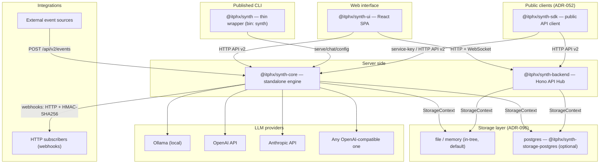
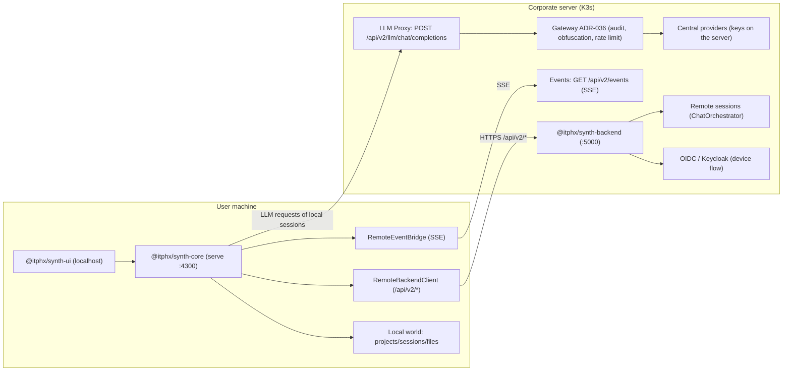

# Synth architecture

> 🌐 **English** · [Russian](../ARCHITECTURE.md)

> [!NOTE]
> User deployment scenarios (local, Docker, Kubernetes, hybrid) live in the
> documentation portal: https://docs.synth.itphx.ru/deploy/local/.

## Components

Synth consists of seven packages in a monorepo:

| Package | Purpose | Stack |
|-------|-----------|------|
| **@itphx/synth-shared** | Types, interfaces, Zod schemas, protocols, configuration | TypeScript |
| **@itphx/synth-core** | Standalone engine: sessions, queue, LLM providers, CLI, HTTP API v2 | TypeScript, Hono |
| **@itphx/synth-storage-postgres** | Optional storage-layer driver over PostgreSQL (ADR-097/PROP-032): implements the `StorageContext` domain ports, `peer-dep` core, `pg` — optional | TypeScript, `pg` |
| **@itphx/synth-backend** | API Hub: OIDC, Runner Registry, LLM Proxy, RBAC, SessionEventBus | TypeScript, Hono |
| **@itphx/synth-ui** | React 19 SPA + admin panel (role-based rendering) | TypeScript, React 19, Vite |
| **@itphx/synth-sdk** | Typed public API client (ADR-052): a wrapper over `public-OpenAPI` (`events`/`sessions`/`schedules`/`llm`) | TypeScript, ESM |
| **@itphx/synth** | Published thin CLI wrapper (`bin: synth`) over core/ui/shared (ADR-038). Does not bundle core and does not copy assets | TypeScript, commander |

The public HTTP contract is described by a **`public-OpenAPI`** spec (28 operations of the
integration core, `packages/core/src/server/openapi/public-openapi.ts`, served by
`GET /api/v2/openapi.json`); the SDK consumes it — a single client layer over the public API.

## Architecture diagram



## Deployment scenarios

### Cloud (teamwork)

```
synth-ui (employee browsers) ←→ synth-backend (:5000)
```

- A single source of truth for sessions and history
- Collaboration: several users in one session
- Centralized audit of all LLM requests
- RBAC: the ADMIN, USER, LEAD, AUDITOR roles
- Provider API keys are stored on the backend only

### Local (one developer)

```
synth-ui (localhost) ←→ synth-core (:4300)
```

- One command: `synth serve --api-key <key>`
- Direct access to the file system
- No backend, Keycloak or Kubernetes required

### Local + external engines (planned)

External engines (opencode/cline) through the built-in Runner bridge are **not implemented**
(plan: ADR-018, PROP-050). The plumbing remains in the core: the `serve --runner` flag and the
`runner` config section, but there are neither engine adapters nor routing; actual execution
is performed by the `synth` engine itself.

### Hybrid (local + corporate server)

Implemented (requirements and status — [HYBRID.md](../HYBRID.md)).

The scenario: a user runs `synth serve` on their machine and connects it
to a corporate server (`synth serve --connect https://synth.k3s.itphx.loc`).
The local core becomes an **aggregator of two worlds**: local and remote
(backend) projects/sessions are available from a single local UI. Remote sessions
are executed by the server and local ones by the local engine, but their LLM requests go
through the **LLM Proxy** on the server (centralized keys, models and audit, ADR-036).



Key elements:

- **Aggregating the worlds:** every entity carries an `origin: 'local'|'remote'` field,
  and remote ids are `remote:<uuid>` (this rules out UUID collisions between worlds); project and
  session lists are merged, and requests are routed by world.
- **RemoteBackendClient** (`packages/core/src/remote/client.ts`) — an HTTP client
  for the server's `/api/v2/*`: auth (OIDC device flow / API key), timeouts, retries and
  "server unavailable" errors.
- **RemoteEventBridge** (`packages/core/src/remote/event-bridge.ts`) — relays the server's
  SSE into the local EventBus; events of remote sessions are rewritten to
  `remote:<id>` and reach the UI.
- **LLM Proxy** (`packages/backend/src/routes/llm.ts`) — the OpenAI-compatible
  `POST /api/v2/llm/chat/completions`; it pushes requests through the Gateway (ADR-036).
  With `remote.llm: server` local providers are disabled entirely.
- **publish / fork** (`packages/core/src/remote/transfer.ts`) —
  `synth project publish <id> --remote` (local project → server) and
  `synth project fork <id> --remote` (remote project → local); they transfer
  the project + sessions + files (backend: `GET /sessions/:id/export`,
  `POST /sessions/import`).
- **Status and offline:** `GET /api/v2/hybrid/status` →
  `{ enabled, connected, backendUrl, user }`; when the server is unavailable the local
  world keeps working and explicit remote operations return 502 OFFLINE.

## Key decisions (AD)

The full index of architecture decisions (AD) with statuses is in the root
[AGENTS.md](../../AGENTS.md), in the "Architecture decision index" section.

## Storage layer (backends)

Physical storage is behind **domain ports** ([ADR-096](../arch_decisions/adr-096-storage-layer.md)):
the domain works with `StorageContext` (`packages/core/src/storage/ports/*`, 27 ports) and the backend is
swappable. The assembly point is `packages/core/src/storage/storage-context.ts`
(`createFileStorage`/`createMemoryStorage` + the async cascade `createStorageContextAsync`/`buildStorageContext`);
the choice — `storage.backend` (`file`|`memory`|`postgres`, env `SYNTH_STORAGE_BACKEND`).

- **`file`** (default) — `FileStore`/`JsonStore`, JSON + atomic tmp→rename write ([ADR-005](../arch_decisions/adr-005-json-storage.md)); **`memory`** — in-memory (hermetic tests, semantics reference).
- **`postgres`** — the second selectable backend ([PROP-032](../arch_decisions/prop-032-history-storage-postgresql.md)): a separate in-tree driver package **`@itphx/synth-storage-postgres`** ([ADR-097](../arch_decisions/adr-097-storage-provider-class.md)), loaded by core via a dynamic `import()`; `pg` is optional. Any backend must pass the contract suite `packages/core/src/storage/contract/*` (the "port passport"); running the driver against a live DB is gated by env `SYNTH_TEST_POSTGRES_DSN`.
- **Degraded mode** ([ADR-098](../arch_decisions/adr-098-storage-degraded-recovery.md)): when the DB is unreachable, the service starts on a file fallback in strict read-only (ADMIN-only, `/health` → `degraded`); there is no auto-return — only a restart. Configuration/dependency/"schema newer" errors — fail-closed.
- **Not everything is behind the ports:** the "file perimeter" stays file-specific/hybrid — secrets in `secrets/` (master key, API keys), `meta.json`/`synth migrate`, `workspaces/`, skill and prompt content, audit journals (`audit/*.jsonl`), instruction URL caches ([ADR-091](../arch_decisions/adr-091-backup-restore-transfer.md)/[ADR-092](../arch_decisions/adr-092-instance-lifecycle-maintenance.md)).

## Monorepo structure

```
synth/
├── pnpm-workspace.yaml       # pnpm workspaces
├── tsconfig.base.json        # shared TypeScript config
├── eslint.config.js          # linter
├── .prettierrc               # formatter
├── scripts/                  # dev.sh, build.sh, standalone.sh, hybrid.sh, publish*.sh, version-bump.sh, changelog.sh, …
└── packages/
    ├── shared/   → @itphx/synth-shared
    ├── core/     → @itphx/synth-core
    ├── storage-postgres/ → @itphx/synth-storage-postgres (opt. DB driver, ADR-097/PROP-032)
    ├── backend/  → @itphx/synth-backend
    ├── ui/       → @itphx/synth-ui
    ├── sdk/      → @itphx/synth-sdk (public API client, ADR-052)
    └── synth/    → @itphx/synth (thin CLI wrapper, bin: synth)
```

## The "Runner" model (planned)

The bridge between the backend and external engines (opencode/cline) is **not implemented**
(plan: ADR-018, PROP-050). The intended runner brings up the LLM Proxy and routes
requests to the selected engine; engines are stateless (history lives on the backend).

## Stateless engine model

The message history lives on the backend. The engine receives as input:

- The message history
- The new user message
- Context (system prompt, project, status)

This provides:

- Collaboration (several users in one session)
- Switching engines without losing context
- Restarting an engine without losing history
- A message queue on the backend, delivered one message at a time

## System prompt composition (SystemPromptComposer)

The system prompt is composed by `SystemPromptComposer` (`engine/context/composer.ts`, ADR-070) —
the **single composition point** for the main session and for subagents. `ContextBuilder` supplies "raw"
blocks, the orchestrator does not concatenate strings; specialized prompts (debug echo,
`SUMMARIZER.{lang}.md`) are the exception and stay inline.

- **Three tiers, sent in the order `stable` → `context` → `volatile`.** `stable` holds the blocks that are
  byte-for-byte constant for a session: role-prompt (+ the "profile empty → interview", "no project → suggest creating one" policies),
  `[ADDITIONAL CONTEXT]` (SOUL/COMPANY/ABOUT), `GATEWAY`, `PLAN_GUIDE`, the `mode.policy` mode policy.
  `context` — profile, `[PROJECT: info.md]`, project instructions (ADR-069), the skills catalog (ADR-046),
  `[SESSION INFO]`. `volatile` — sticky, participants, summary, compact state markers,
  `[CLASSIFICATION]` (config gate), the interview artifact.
- **The rule "policy goes to `stable`, state goes to `volatile`".** Only what is constant
  for the whole session lands in `stable`; everything conditional/transient (the questionnaire text, the fact
  that the profile is empty) goes to `volatile`, **after** the stable-prefix boundary (the boundary is after
  `mode.policy`). A conditional block appearing or disappearing does not
  invalidate the cacheable prefix.
- **Idempotency and byte-stability.** `compose()` assembles the prompt from state **from scratch** (no
  `base + …`); while the state is unchanged, `stablePrefix` is byte-stable. `Date.now()` with second
  precision does not land in `stable` (the date is date-only). By design this eliminates the bug of duplicated
  blocks after `plan_enter`/`plan_exit`.
- **Mode/plan/todo are chronological system messages of the history, not the system prompt.** `MODE_*`/`PLAN_MODE_*`/
  `[APPROVED PLAN]`/`[TODO]` go out as durable `role: system` messages (`metadata.type` =
  `mode_change`/`plan_updated`/`todos_updated`/`agent_switch`; hidden **in the UI only**), wrapped
  for the LLM in `<system-state type="…">`. The rationale is the invalidation hierarchy `tools → system → messages`:
  a turn event must not reset the system cache. Changing the mode/plan/todo does not recompose the system baseline.
- **CachePolicy lives in providers/Gateway, not in tools** (ADR-036): Anthropic — `system` as an array of blocks with
  `cache_control` (≤4 breakpoints, priority tools → system → messages; the two system breakpoints are the end of
  the stable prefix and the end of system; the default TTL is `5m`, the `1h` option is not enabled); OpenAI —
  `prompt_cache_key` (a stable session id; `agentKey` is not part of the key — agents are isolated via their
  `staticPrefix`/`promptStates`) + `stream_options.include_usage`. Markers are placed **after**
  normalization/sanitization; `none` disables both the markers and the key.
- **Usage/statistics.** A normalized `Usage` (`input`/`output`/`nonCached`/`cacheRead`/`cacheWrite`/
  `reasoning`/`total`, with the invariant `nonCached + cacheRead + cacheWrite = input`); cost with cache
  read/write; the **cache hit rate** — the share of cached input tokens of a session (session/API/UI).
- **Prompt state is per-agent.** `session.promptStates[agentKey]` (`agentKey` = agentRole or
  `__default__`): generation, `staticPrefixHash`, the pinned bytes of `staticPrefix`, block hashes.
  Written **only when the generation changes**; every assistant message carries a compact `promptMeta`
  (`agentRole`, generation, `expected: hit|miss`, the actual cachedTokens, `validated`). Changing the mode and
  the model/provider does **not** bump the generation (a model change yields `expected: 'miss'` without recomposing
  the stable prefix); switching the agent does not reuse someone else's prefix. Subagent `promptStates` are not persisted.
- **Transparency.** A manifest of sources (`key`/`label`/`tier`/`chars`/`estTokens`/`status`/`provenance`/
  `source`) + the `tools` entry (the earliest cacheable layer, inserted at the end of the `stable` tier) + the history
  layer (`PromptHistoryInfo`); `manifest()` and `compose()` use a single traversal, and there is a parity test
  "manifest ↔ bytes sent". The API `GET /api/v2/sessions/:id/prompt` (manifest + history +
  promptState + promptMeta) and the UI section "Prompt composition"; `DebugCollector` is threaded through every creation point.
- **The `ContextSource` seam** (`{ key, load(ctx) }`) — groundwork for a future source registry (today the sources
  live inside the Composer).
- **Tools are constant across all modes** (plan/act/yolo): `_filterToolsByMode` has been removed, so restrictions come
  from the permission layer only, extended with the `ToolAccess` availability axis (`allow`/`ask`/`deny`/`unavailable(mode|role)`;
  the `dependency` reason — ADR-078). Availability is **not** encoded in a tool's `description` (it sits in the tool prefix).

Module/type mechanics — `packages/core/AGENTS.md`; configuration — `docs/CONFIGURATION.md` (`llm.cache`);
the endpoint — `docs/API_V2.md` §5.5; UI — `packages/ui/AGENTS.md`.

## Skills and slash commands

The skills and `/` command mechanism (ADR-046). A skill is a folder with `SKILL.md` + supporting files;
skills are **instructions**, they do not register new tools, and the only core tool is `skill`.

- **Discovery** (`engine/skills/*`): `{project.workspace}/.synth/skills` (project) >
  `{dataDir}/skills` (instance) > `config.skills.paths` > external read-only directories
  (`.opencode/skills|skill`, `.claude/skills`, `.agents/skills`, `~/.config/opencode/skills`) >
  `config.skills.urls` (a read-only index in `{dataDir}/skills-cache`, `trusted:false`).
  Dedup is first-wins, the losers become `shadowed`; the cache is invalidated lazily by mtime/size (`watcher.ts`).
- **Project trust** (`trust.ts`): skills from an untrusted project directory (one absent from
  `skills.trustedProjectDirs`) are visible but not loaded — protection against substitution through `git pull`.
- **Catalog in the prompt** (`catalog.ts` + Composer): only `name` + a trimmed `description`;
  the stable part (system/project) goes to the `stable` tier, session dynamics/`unavailable` to `volatile`.
  The catalog is added for subagents too (`task`, the parent's binding).
- **The `skill` tool** (`tools/skill.ts`): the body of `SKILL.md` as `<skill_content>` + base dir +
  ≤10 supporting files; truncated by `ToolOutputStore` (50 KB / 2000 lines); capability-aware —
  when capabilities are missing, delegation through `task`.
- **Enablement levels** (`scope.ts`, following the ADR-071 §2.4 model): `system`/`project`/`session`; the hard gate
  (the master `disabled`, `project.enabled`) is live; defaults/snapshot (`skillsDefaultOn`) are snapshot-based;
  the default is opt-in. A single resolver — `resolveSkillAvailability`.
- **Slash commands** (`engine/commands/*`): resolved in the core before the LLM (UI/CLI/hybrid); built-in
  (`/help`, `/skills`, `/commands`, `/summary`, `/init`), template `.md` ones (`$ARGUMENTS`/`@file`),
  skills-as-commands and bundles (`/bundle-name`); permissions via `permission.rules.command`; inline shell
  (`` !`cmd` ``) — opt-in through `execute_shell`. The events `skill.invoked`/`command.invoked`;
  the `skill-creator` builtin is a skill instruction in code.

Endpoints/RBAC — `docs/API_V2.md` §5.17–§5.17.2; configuration — `docs/CONFIGURATION.md`
(the `skills`/`commands` sections); the `SKILL.md` format — `packages/core/AGENTS.md`.

## Project instructions (AGENTS.md)

Auto-loading of repository instructions (ADR-069) — a separate tier between the global identity
and nested subdirectories.

- **Tiers (do not mix them):** identity (`SOUL.md`/`COMPANY.md`/`ABOUT.md`) → project
  instructions (only with `project.workspace`, ADR-014/ADR-040) → nested subdirectories
  (lazy). The `[PROJECT INSTRUCTIONS]` block is part of the `context` tier (ADR-070).
- **Discovery** (`engine/context/instructions.ts`, `ProjectInstructionsResolver`): a merged chain
  `git root → … → workspace` (deeper = later = higher priority), exactly one candidate per directory
  (`AGENTS.override.md` > `AGENTS.md` > `agents.md` > `CLAUDE.md` (opt-in) > `CONTEXT.md`
  (deprecated)); dedup by sha256; the provenance header `--- from <path> (<chars> chars[, truncated]) ---`
  (the path is relative to the workspace). `config.instructions.sources` (`path`/`url`) are inserted `before`/`after`
  the chain; URLs are fetched read-only with a TTL cache in `{dataDir}/instructions-cache` (no background timer)
  and capped by `maxBytes`.
- **Truncation:** head/tail (`headRatio`/`tailRatio`) with the marker
  `[TRUNCATED: see <path> — read_file(path, offset, limit)]`; the cap is dynamic, derived from the model window
  (`clamp(windowRatio*window, minChars, maxCharsCeiling)`) and shared across the chain; `maxChars` is an override.
- **Threat scan** (`engine/security/prompt-injection.ts`, ADR-036) before insertion: `block` — the block
  is not loaded, `flag` — a WARN line. The gates are project trust (ADR-046, shared with lazy loading) and
  the install-tree guard (inside Synth's source tree — `skipped-install-tree`).
- **Lazy loading** (`engine/context/lazy-instructions.ts`): driven by file/shell tool arguments
  (`LAZY_TRIGGER_TOOLS`) it looks upward for the nearest instruction file (≤`lazy.maxAncestors`), only
  inside the `workspace` and excluding `lazy.excludeDirs`; dedup (`loaded` + sha256); the content goes
  **into the tool result** (`[Subdirectory context discovered: <path>]`), once per
  assistant message, rather than into the system prompt (prompt cache). The state is per-session in the orchestrator.
- **Cache/invalidation:** candidate signatures (`engine/file-signature.ts`, `mtime:size`) → the resolver's
  result cache (`.clear()` resets it) + per-turn memoization in the orchestrator; a TTL slot for URL signatures.
  A snapshot for the UI — `GET /api/v2/context/instructions` + the `context.instructions_loaded` event.

Configuration — `docs/CONFIGURATION.md` (`instructions`); `/init` and the `synth-agents-md` skill — ADR-046.

## External events and hooks

The core of ADR-030 (min) + ADR-089: agent events and external events go through a shared
hook bus, and session creation is consolidated into a single funnel.

- **`HookBus`** (`engine/hooks/hook-bus.ts`) — the lifecycle hook bus of the agent
  (`session_requested`, `external_event`, …); async hooks with a timeout
  (`HOOK_ASYNC_TIMEOUT_MS`), and a result can block an event (`blocked`/`reason`).
  This is the foundation; the Plugin SDK and plugin loading (PROP-090) are not implemented.
- **Entities** (`shared/types/events.ts`, with the Zod schemas next to them). `SynthEvent` — a normalized
  external event `{id: 'evt_<uuid>', source, type, payload, identity{principalId?, chatKey?,
  threadKey?, roles?}, dedupKey, ts}` (known `source` values: `telegram`/`synth-media`/`webhook`/
  `cron`/`ci`/`ui`; `identity.roles` is the sender's permission ceiling, narrowing the profile roles);
  `EventBinding` — `{source, chatKey?, threadKey?, sessionId?, mode: bound|ephemeral|queue,
  agentTemplate?, project?}`; `RouteDecision` — `bound|ephemeral|queue|drop|bind`
  (`drop` carries `reason`+`audited`, `bind` is auto-bind); `EventBindingApiKey` — a binding
  API key (see below).
- **`EventRouter`** (`engine/events/event-router.ts`) — a pure per-event decision
  plus a journal entry. The `decide` order is: `allowedSources` (not in the list → `drop`) →
  dedup by `dedupKey` (a lazy cache built from the journal) → an explicit `EventBinding` by
  `threadKey`/`chatKey` → the registered `RouteRuleProvider`s (the first non-empty one) →
  the `drop no_route` fallback. Every drop is "audited" — no event is lost silently.
- **`EventBinding`** (`bound | ephemeral | queue`) links an external address
  (`source` + `chatKey`/`threadKey`) to a session/template; it is stored in
  `EventBindingStore`, while decisions go to `EventJournalStore` (the journal, ADR-005).
- **Binding API keys** (`EventApiKeyStore`, `{dataDir}/events/api-keys.json`, ADR-089/ADR-052) —
  the first slice of the public API: a mandatory, globally unique `label` +
  `description`/`expiresAt`/`rateLimitPerMinute`, soft revocation (`revoke`); the secret
  `synth_evt_<base64url>` is stored only as a sha256 hash
  and handed out once; ingestion at `POST /api/v2/events` with `Authorization: Bearer <binding-key>`
  authenticates without user credentials (the source/chat come from the binding), and usage is written
  to the journal (`keyId`); the per-key rate limit is the key's own limit or the global `events.keyRateLimitPerMinute`
  (`KeyRateLimiter`, 429); keys are instance-local (they are not transferred by publish/fork).
- **Service keys** (`ServiceApiKeyStore`, `{dataDir}/service-keys.json`, ADR-052 stage I) — a scoped instance
  key for external services, independent of binding keys: the secret `synth_svc_<base64url>` (at-rest
  sha256), a mandatory unique `label`, `roles`/`scopes`/`allowedProjects` (project projection)/
  expiry/limit; it authenticates a machine as a synthetic user, `scopes` restrict endpoints
  (`requireScope`, `packages/core/src/server/service-scope.ts`), and the projection covers sessions/events/schedules.
  The CRUD endpoints and the scopes — `docs/API_V2.md` §5.28/§1.
- **`RequestSessionService`** (`engine/events/request-session.ts`) — the single funnel for
  session creation: `request` (explicit creation from the UI/CLI/agent, emitting
  `session_requested`) and `handleEvent` (`external_event` → `decide` → materialization
  → `deliver` → `record`). `POST /api/v2/sessions` goes through it as well; the endpoint's
  external contract has not changed.
- **`EventIngress`** (`engine/events/ingest.ts`) — the ingestion point: it normalizes the input into
  a `SynthEvent` (id `evt_<uuid>`, a default dedup key) and passes it to the funnel.
- **Webhooks** (`WebhookStore` + `WebhookService`, ADR-052 stage II) — an **outbound** bridge,
  the reverse loop of incoming events: `WebhookService` subscribes to all bus events
  (`eventBus.subscribeAll`), filters them by subscription patterns (`matchWebhookEvent`) and sends
  subscribers HTTP POSTs with an HMAC-SHA256 signature; retry/backoff with jitter, dedup by
  (subscription + event), timeout, a delivery journal (`{dataDir}/webhooks/deliveries.jsonl`) and
  the delivery target address policy — `egress.webhooks` (`engine/net/egress-guard.ts`:
  `checkEgressUrl`/`fetchWithEgressGuard`, redirects with per-hop checks; ADR-099). The endpoints and the
  signature format — `docs/API_V2.md` §5.29; configuration — `docs/CONFIGURATION.md` (`webhooks`, `egress` sections).
- **Ephemeral sessions** for external events receive `expiresAt` from `ttl`
  (`config.events.ephemeralTtl`, default `24h`); cleanup is handled by `startEphemeralSweeper`.
  The `queue` mode is delivered as `defer` (the message is put in the queue without starting the processor).

The chain:

```text
external event → EventIngress (SynthEvent) → RequestSessionService
  → HookBus (external_event) → EventRouter.decide → materialization
  → session (bound/ephemeral/queue) → deliver → journal/UI event
```

API endpoints and RBAC — `docs/API_V2.md` §5.26; configuration — `docs/CONFIGURATION.md`
(the `events` section). Sources/integrations: the ADR-051 scheduler (cron), binding API keys, service
keys with scopes and a project projection, webhooks, `public-OpenAPI` (28 operations, `GET /api/v2/openapi.json`)
and the `@itphx/synth-sdk` SDK — **ADR-052 is closed in full (stages I–IV, including moving the Telegram gateway
to a scoped service key)**; the first add-on is the Telegram gateway (`addons/synth-gateway-telegram`) —
implemented; plugins (Plugin SDK, PROP-090) and pipelines (PROP-059) are not implemented.

## Egress layer (outbound connections)

All outbound HTTP(S) calls of Synth go through a single layer (ADR-099) rather than through a "raw" `fetch`
in each subsystem. Three orthogonal parts:

1. **TLS/CA trust (start-only).** The `security.tls` section (`caFile`/`caPem`, mTLS, `rejectUnauthorized`)
   → `initTlsTrust` → the global undici dispatcher; `egressFetch` is a `fetch` with an explicit dispatcher
   (`packages/core/src/security/tls.ts`).
2. **Address policy (runtime, live per-request).** `egress.tools`/`egress.webhooks` and
   `mcp.networkPolicy` (`{mode, list, exceptions}`) are resolved from the store on every request; the check
   is `engine/net/egress-guard.ts` (`checkEgressUrl`/`fetchWithEgressGuard`, per-hop redirects, fail-closed).
   Changes go to `{dataDir}/audit/security.jsonl`, requests to `{dataDir}/audit/egress.jsonl`.
3. **Proxy (configured at runtime, applied at startup).** The `proxy` section (HTTP/HTTPS/SOCKS5, Basic,
   TLS/mTLS to the https proxy, `noProxy`) from `config.yaml`/env **or the runtime override from the admin
   UI** (`RuntimeSettings.proxy`, `settings.json`/PG; priority `SYNTH_PROXY_*` > runtime > config) →
   `EgressDispatcher` (`packages/core/src/security/proxy-dispatcher.ts`): per-origin direct/proxy choice,
   fail-closed `EGRESS_PROXY_UNAVAILABLE`, `407` without a direct fallback. Application is two-step: an early
   `initTlsTrust` (TLS/PG), then `applyStartupProxyConfig` after the storage is built and **before** deps;
   `PUT /settings/proxy` only saves (`restartRequired`), there is no live switch. git gets the proxy via
   child env (`http_proxy`/… through libcurl), `stdio` MCP via the child process env; PostgreSQL is not proxied.

With a proxy enabled the address policy runs in **proxied mode**: only the scheme and hostname rules are
checked, no DNS/CIDR (the proxy resolves the address); for `noProxy` hosts the check is full. The actual
route is written to the journal (`via`: `proxy`/`direct`/`fallback`). API — `docs/API_V2.md` §5.21
(`settings/egress/*`, `settings/proxy*`), configuration — `docs/CONFIGURATION.md` (`egress.*`, `proxy.*`,
`security.tls`); limitations (NTLM/Kerberos, SOCKS + target CA, IP/SNI) — ADR-099 and PROP-088.
